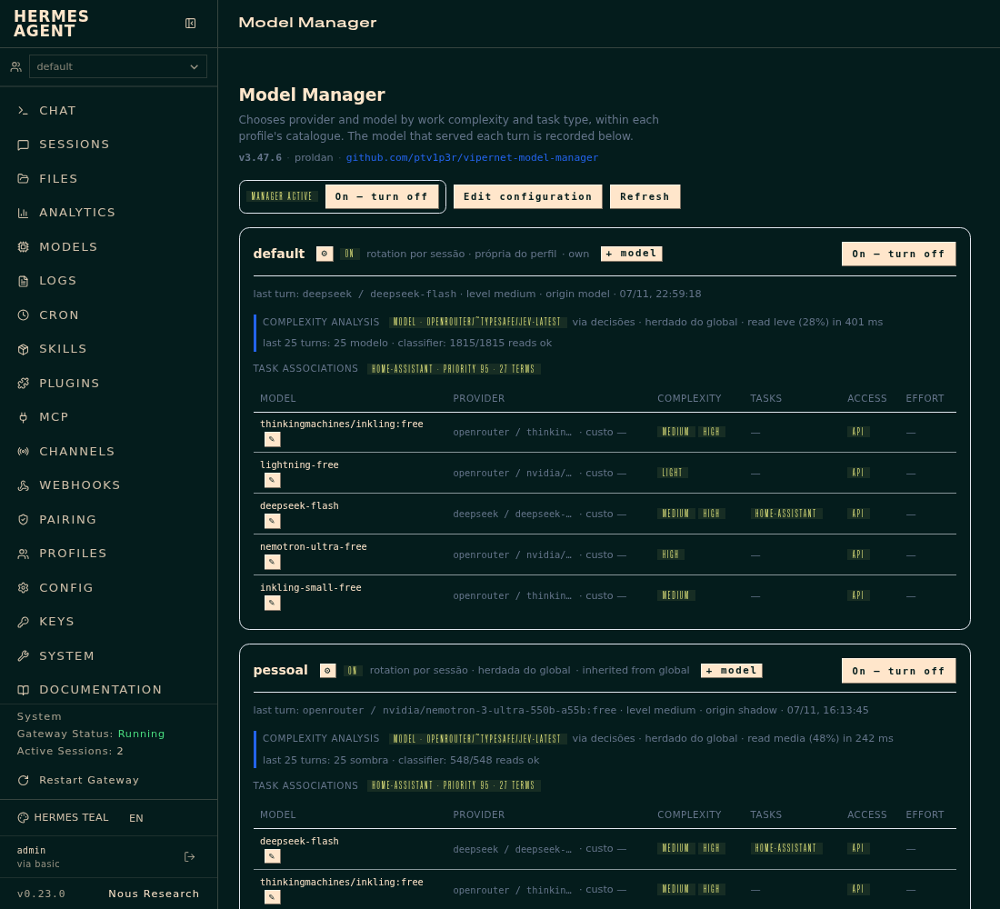
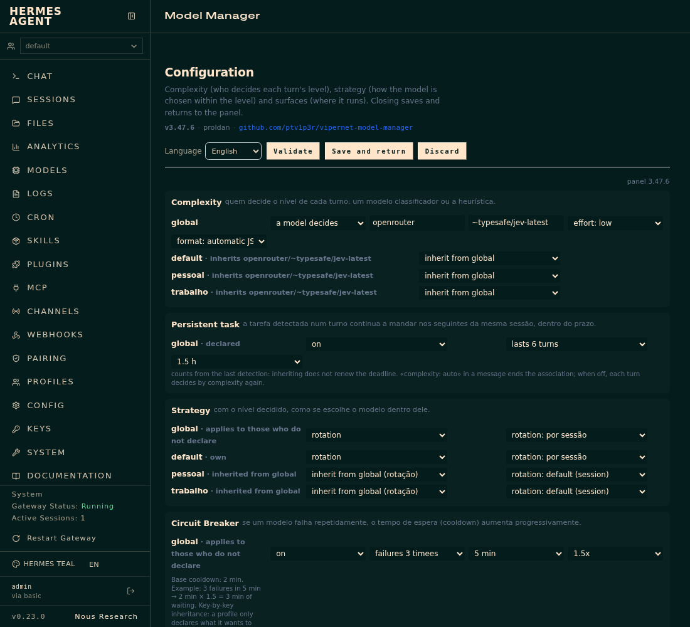
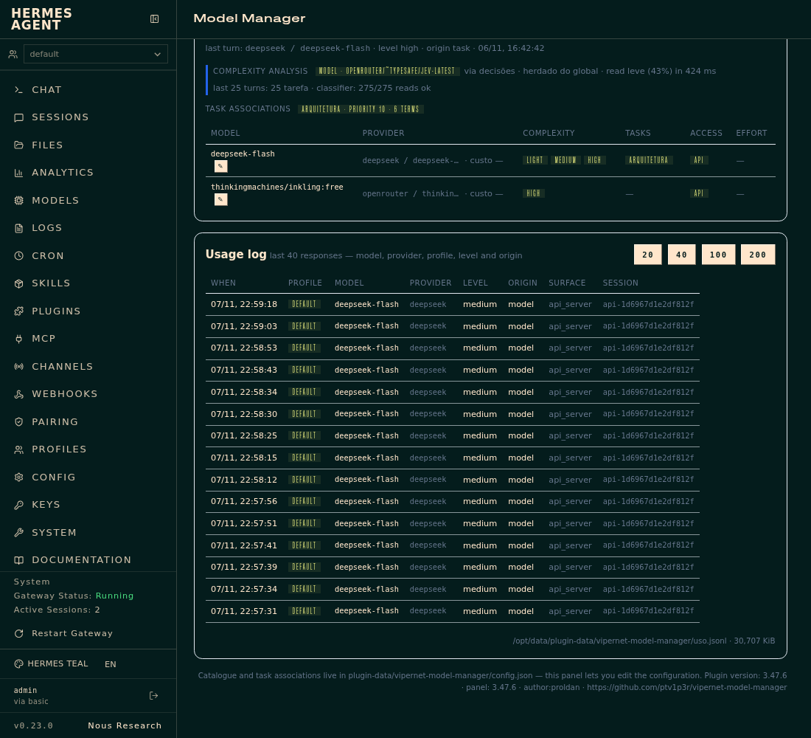

# vipernet model manager

**English** · [Português](README.pt-PT.md)

Picks **provider + model** on every turn from the complexity the turn
shows — not from a label the owner wrote — inside the catalogue
the owner declared **for the profile being served**.

**Repository:** https://github.com/ptv1p3r/vipernet-model-manager — public, and the place the
catalogue installs from. Work happens on the private Gitea mirror
(`proldan/vipernet-model-manager`), which push-mirrors here on every commit and every 8 h.
The catalogue entry to submit lives in `plugin-catalog/vipernet-model-manager.yaml` and is
pinned to a commit that carries this file.

Three sentences that sum up the contract:

1. **Complexity is measured** (last message + state of the work): size of the
   own text, engineering verbs, code blocks, tracebacks, paths,
   turns and tools used. `complexidade: alta` still exists as an
   explicit override, but the normal path is the analysis.
2. The **catalogue is closed and belongs to the owner**. Outside the declared
   entries there are no routes. Each entry says which complexity levels it
   serves. An entry whose credential does not resolve is skipped, with a record.
3. Each **profile** decides whether it uses the plugin, how it uses it
   (strategy) and with which list. A profile absent from the config is untouched.

## Screenshots

The dashboard tab **Model Manager**, at `v3.47.6`, captured from a live install:

| Capture | What it shows |
|---|---|
|  | **Overview** — manager state, the model that serves each profile, its complexity analysis and the task associations. |
|  | **Configuration** — who decides each turn's level, how the model is chosen within the level, the persistent task and the circuit breaker. |
|  | **Usage log** — what was served turn by turn: model, provider, profile, level, origin and surface. |

The owner's full name is replaced by the public handle in these captures.

## Complexity analysis (3.5)

Two paths, and the second is optional:

1. **Heuristic** (always available, no cost): scores independent signals and
   cuts at two thresholds — `leve` (< medium), `media` (>= 3) and `alta` (>= 6).
2. **Classifier model** (opt-in): a model chosen by the owner answers
   `leve`/`media`/`alta`. Defined globally or per profile, with its own
   switch in each scope. With no model defined, or with the switch down,
   the heuristic applies — the behaviour does not change.

Decision order per turn, from strongest to weakest:
**explicit marker** (`complexidade: alta` in the message) **> task
association > classifier model > heuristic**. The first three sources only
decide the level; the route (provider+model) always comes from the profile catalogue.

The block lives in `analise.classificador` (global) and in
`perfis.<nome>.analise.classificador` (per profile). The profile block
**replaces the global one entirely** — which is what lets a profile disable
(`{"activo": false}`) what the global config enables. A profile that does not
declare the block inherits it; and what gets saved is never a copy of the global (a copy
would pin the profile to that day's value and stop following changes to the global).

```json
"classificador": {
  "activo": true, "provider": "inception", "modelo": "mercury-3",
  "timeout_s": 12.0, "max_tokens": 320, "cache_ttl_s": 600,
  "janela_mensagens": 8, "max_chars": 4000
}
```

**Fail-open by design**: a network error, `HTTP != 200`, a response without one of the three
levels, or an exceeded `timeout_s` return `None` — the heuristic decides and the reason
stays in `classificador_erro` in the ledger. The circuit breaker opens in two
different ways, because failures do not cost the same: **one timeout suspends the
first** (it costs the whole `timeout_s` in turn latency, and the heuristic
answers in 0 ms; waiting three times to hear what the first already said is paying
3x for nothing — measured 2026-11-03: four failures in 45 s on the `pessoal` profile at
8 s timeout), and three failures of another kind (5xx, unreadable response) suspend
as before. The response is capped by `max_tokens` (320) and the same last
message is not paid twice within `cache_ttl_s`.

**One failure is one failure, not one per request in the turn**: the level is pinned in the
turn, and so is the error. Only the first request's event carries
`classificador_erro`; the following ones carry `classificador_erro_herdado` and do not
count towards the rate. Without this, a turn of 14 requests (measured 2026-11-03, `default`
profile) showed up as 14 failures on the card and in the accounting.

**Output budget and reasoning models** (measured 2026-11-02): `deepseek-flash`
thinks before answering. With `max_tokens: 12`, the 12 output tokens were all
`reasoning_tokens` and `content` came back empty — the classifier
was failing on budget, not on quality. With 320, the same message returns
`alta` in 1.3 s (196 input tokens, 59 output, ~0.00008 USD). A reasoning
model cut short still delivers the level: when `content` comes back empty,
`reasoning_content` is read and the last level the model wrote stands.

Enable/disable, without editing JSON:

```sh
vmm classificador                            # effective state per profile
vmm classificador on --provider inception --modelo mercury-3
vmm classificador off --perfil pessoal       # disables only in this profile
vmm classificador on --perfil trabalho --provider openrouter --modelo x/y
```

**The classifier provider must exist in the profile being served** (measured
2026-11-03). The classifier resolves against the **profile's** `config.yaml`, not
against the process one: an `inception/mercury-3` that works on `default` fails on
`pessoal` with `AuthError: Unknown provider 'inception'` while the
`providers.inception` block is not declared there — `hermes -p pessoal config set
providers.inception.{name,base_url,key_env,api_mode,default_model}`, with
`key_env: INCEPTION_API_KEY` and `api_mode: chat_completions`. An error like this is
`sem_efeito` with a `motivo` and a 1 h suspension, not a transient failure: it does not open the
circuit breaker nor count towards the rate. The key comes from the secrets sources for the
gateway process, not from the profile's `.env`.

Current state: the global is `inception/mercury-3` and the three profiles inherit it. A
profile that wants another model declares its own block — from then on it is
`próprio do perfil` and stops following the global, which is the price of not having a
copy pretending to be inheritance.

In the panel, the **Complexity analysis** section (inside the editor) has one row
per scope — global and each profile — with three states per profile: *herdar do
global*, *desligado (heuristica)* and *decide um modelo* (with provider and model).
It saves through the same `/config`, after validation.

Heuristic signals and what separates them:

- **Verifying is not analysing.** "testa o plugin", "adiciona um teste" — the verb is
  confirmation, not analysis work; `_ANALISE` ignores verification verbs.
- **Maintenance separate from work.** `corrigir`, `adicionar`, `atualizar` and
  `revisar` score 3 (`manutencao`), not 5 (`trabalho`) — a typo in the README does not
  buy an expensive model. But if the target is a **live system** (automation, service,
  installation, container), it scores `trabalho` again: it is production, not fine maintenance.
- **Planning and reporting have their own category.** `planeamento` (5): plan,
  window, rollback, migration proposal. `relatorio` (3): recurring summary/report,
  which produces but is cheap.
- **Diagnosis dropped from 6 to 4** (`auditoria`): "porque o inversor nao liga"
  is analysis work, but not the weight of an architecture decision (6).

Measurement that fixed the thresholds (2026-11-02, two holdouts, 42 cases):

| variant | holdout1 (24) | holdout2 (18) | total |
|---|---|---|---|
| `media=3` (in force) | 24/24 | 17/18 | **41/42 (98%)** |
| `media=4` | 20/24 | 14/18 | 34/42 (81%) |
| `media=3` + 2-signal rule | 21/24 | 14/18 | 35/42 (83%) |

The two-signal rule (`media_sinais: 2`) stays implemented and **inactive**: it only
acts when the key exists in the thresholds. `test_holdout.py` versions holdout2
with a 17/18 baseline — the only known error ("NPM ou Traefik, justifica") is
debatable in its label and **is not used for calibration**.

## v4.3 — what separates things now

Concept corrections, each born from a real failed case:

- **`justificacao` (3)**: "justifica" asks for a reason, it does not design. It used to score 6 and
  sent "NPM ou Traefik? justifica" to the expensive model.
- **`explicacao_conceito` (2)**: "explica como funciona X" is medium-difficulty
  reasoning.
- **`avaria_de_servico` (+3)**: a symptom on a process that should be
  running (`_SERVICO_AVARIADO`). A lamp that does not turn on is not this.
- **Restricted live object**: `ha`, `bateria`, `inversor`, `dashboard` and
  `api` were removed. `ha\b` matched the Portuguese verb "ha" (normalised text without
  accents) and promoted a typo to production work.
- **Generic verbs** (`prepar`, `gera`, `faz`, `produz`): they inherit the weight of the
  object; "gera o relatorio mensal" is reporting (3), not engineering (5).
- **`mudar` in a question is not an order**: only `muda`/`mude` count as maintenance.
- **Infra vocabulary**: `lxc`, `proxmox`, `portainer`, `backup`, `retencao`,
  `snapshot`, `vlan`, `skills`, `n8n`, `sqlite`, `postgres`, `firmware`,
  `ota`, `consumo`, `standby`, `energia`, `seguranca`, `exposicao`, `homelab`.

### Measurement protocol (important)

The `test_holdout{,2,3,4}.py` holdouts add up to 79 cases. Every time the
vocabulary is tuned against one of them, that set **stops being an independent sample**.
The order that was followed: measure blind, fix concepts, measure on a new set.

| set | cases | before v4.3 | after |
|---|---|---|---|
| holdout2 | 22 | 22/22 (training) | 22/22 |
| holdout3 (blind at the time) | 20 | 12/20 (60%) | 20/20 |
| holdout4 (blind at the time) | 19 | **11/19 (57%)** | 19/19 |

The honest number is **57% blind**, not the 100%. The 8 failures were all
vocabulary — none of them a threshold — and that is why the classifier's bottleneck
is not `media`, but lexical reach. A new sentence with words that are not
in the regexes falls into `leve`. The way out of this is not more regex:
it is a classifier that generalises (a small local model or a free
large-context model answering `leve|media|alta`).


## Dashboard panel (3.3)

The plugin ships its own panel in the Hermes dashboard, on the **Model Manager**
tab (`/model-manager`). It lives in `dashboard/`:

| file | role |
|---|---|
| `manifest.json` | declares the tab (`position: end`), the `entry`, the `css` and the `api` |
| `api.py` | backend mounted at `/api/plugins/vipernet-model-manager/` |
| `dist/index.js` | IIFE using `window.__HERMES_PLUGIN_SDK__` and `__HERMES_PLUGINS__.register` |
| `dist/style.css` | panel geometry (colours and typography come from the host theme) |

Per profile, the panel shows: the switch, the strategy, the **complexity analysis
indicator**, the task associations, the catalogue with each model's complexity and
effort, and the last model served; below, the log of the latest
responses (when, profile, model, provider, level, origin, surface, session).

It writes the switch (global or per profile) and the whole configuration (JSON editor,
`POST /config`, with `POST /validar` first), always through `gestor.gravar` — validation,
backup and `os.replace`, with an independent re-read before answering OK. The log is
read-only.

The host discovers panels via `<plugins root>/<nome>/dashboard/manifest.json`; the discovery
cache of the dashboard process does **not** invalidate itself when a new
panel appears — after installing, restart the dashboard container (or force
`/api/dashboard/plugins/rescan`). The `dist/` files are served from disk on
every request: they change with a browser refresh, with nothing restarted (measured: sha256 of the
served asset equal to the local file). `api.py` is another story: it enters when
the panel backend loads the module — at container start and on plugin
reload (`reload_gateway_plugins`, per profile in a multiplexed gateway). `curl` does not
tell which of the two took effect: `/api/plugins/<nome>/*` answers `401` from the
session gate to outside requests, with or without basic-auth, so backend
verification goes through the authenticated path (the panel in the browser) or in-process, with the
same file. The agent config is read hot (TTL 5 s).

### Identity in the header (3.13.8)

The header shows `v<version> · <author> · github.com/<account>`, with the repository
as a link. The version is **not** a copy written in the JS: `GET /estado` returns
`plugin` with `versao` read from `plugin.yaml` — the same file the loader and the
catalogue read —, `autor` and `github`. If the `version` in `manifest.json` diverges from
`plugin.yaml`, the header shows both numbers in red instead of silently choosing one:
that divergence (panel 3.11.2 with the disk at 3.11.3) is what already made people
doubt which code was running.

`github` is the author's public repository, not the internal Gitea: the catalogue requires
a public repository clonable over https on GitHub or GitLab [1], so the
address the panel shows is the one that serves a submission.

### Per-card analysis indicator (3.7)

Each profile card answers a single question: **is this turn's complexity
being decided by a model — and which one — or by the heuristic?** The bar on the left and the
chip say the mode; the text says the rest:

| what you see | meaning |
|---|---|
| `modelo · inception/mercury-3` + `esforço baixo · herdado do global` | the profile declares no block and uses the global |
| `modelo · inception/mercury-3` + `próprio do perfil` | the profile declares its own classifier |
| `heurística` + `classificador desligado — decide a heurística` | a block exists, but `activo: false` |
| `heurística` + `classificador sem efeito (…) — decide a heurística` | a declared block that fails validation |
| `heurística` + `sem modelo definido` | nobody declared anything, in any scope |
| `últimos N turnos: 22 modelo · 3 heurística` | evidence from the ledger, not from the config |
| `⚠ o modelo falhou no último turno — caiu na heurística: …` | the classifier is on but failed |

The last two rows are what separates **declared** from **deciding**: a
classifier that is on and errs falls back to the heuristic silently, and the config would still
say "on". The count comes from the profile's `resposta` events (last 25) and the
error reason from the last event carrying `classificador_erro`.

A single home for the answer: `gestor.classificador_efectivo(cfg, perfil)` — used
by the card (`/estado`) and by `vmm classificador ver`. It resolves inheritance and
validation; the panel reimplements neither.


Panel self-test (does not touch the live config):

```sh
VMM_DIR=$(mktemp -d) /opt/hermes/.venv/bin/python dashboard/selftest.py
```

## Installation

```sh
ln -sfn /opt/data/plugins/vipernet-model-manager/cli.py /opt/data/bin/vmm
hermes plugins enable vipernet-model-manager            # in the profile that should use it
hermes -p pessoal  plugins enable vipernet-model-manager
hermes -p trabalho plugins enable vipernet-model-manager
```

`hermes plugins enable` reloads the gateway on its own. The config is read hot
(5 s cache), so editing the catalogue **does not** require restarting anything.

## Config

Live file: `/opt/data/plugin-data/vipernet-model-manager/config.json`
(override via `VMM_DIR`, useful for trials). Schema:

```json
{
  "versao": 3,
  "activo": true,
  "registar": true,
  "analise": {"janela_mensagens": 8, "varredura_max_mensagens": 60,
               "limiares": {"media": 3, "alta": 7}, "descer_apos": 2,
               "fixar_nivel_por_turno": true},
  "estrategia": {"modo": "rodizio", "por": "sessao"},
  "perfis": {
    "trabalho": {
      "activo": true,
      "estrategia": {"modo": "prioridade"},
      "analise": {},
      "catalogo": [
        {"id": "deepseek-flash", "provider": "deepseek", "modelo": "deepseek-flash",
         "complexidade": ["leve", "media"], "acesso": "api"},
        {"id": "gpt-sol", "provider": "openrouter", "modelo": "openai/gpt-6.1-sol",
         "complexidade": "media", "acesso": "api"},
        {"id": "gpt-sol-sub", "provider": "openai-codex", "modelo": "gpt-6.1-sol",
         "complexidade": "media", "acesso": "subscricao"}
      ]
    }
  }
}
```

- `activo` (top level) — global switch; `registar` — write the ledger.
- `perfis.<nome>.activo` — that profile's switch.
- `estrategia` — `{modo, por}` block, **closed list**, global at the top and
  inherited by each profile: `modo` is `rodizio` (round-robin within the level) or
  `prioridade` (first eligible entry in the list); `por` is `turno` or
  `sessao` and only governs `rodizio`. A profile declares **only what it wants to change**
  (the delta) and the rest comes from the global; with no block at all, it inherits. See
  «Strategy: closed list with inheritance».
- `complexidade` per entry: `"leve"`, `["leve","media"]`, `["alta"]`… Levels:
  `leve`, `media`, `alta`.
- `acesso` per entry: `api` or `subscricao`. **Explicit or inferred from the
  provider** (openai-codex → `subscricao`, the rest → `api`); it is label +
  validation + record, and never rewrites `provider`/`modelo`. Incompatibilities
  (`subscricao` with a provider other than openai-codex, or `api` with openai-codex)
  are refused.
- the profile's `analise` overrides the global key by key (thresholds, window,
  `descer_apos`).
- Profile `"*"` serves as the default for unlisted profiles; an exact profile wins
  over `*`.
- No profile in the config and no `*`: **not managed** — the turn goes through untouched.

### `alta` level policy (owner's decision, 2026-11-03)

The `alta` level resolves to **`deepseek/deepseek-flash` on all three profiles**, and it is the
only `alta` route declared in the catalogue. The consequence has to be read before
touching anything: **there is no model above flash in the catalogue**, so `alta` does not
mean «better model» — it means «the paid model, without dropping to the free ones». The
classifier's gain is in **cost, not quality**: at `leve`/`media` the route
may rotate to a free model; at `alta` it does not descend.

Anyone editing the catalogue, two rules:

- **Do not add `alta` to another entry without an explicit owner decision.** If a
  free model declares `alta`, round-robin can then serve `alta` with a free model and
  the level stops guaranteeing flash. That is what happened before 2026-11-03: 224
  `alta` events served by `thinkingmachines/inkling:free` in the ledger, all
  with `motor` missing (history from before the marker), and zero afterwards.
- **`deepseek-v4-pro` is forbidden** (owner's decision, 2026-11-03) — out of the
  catalogue, out of the default catalogues in `gestor.py`, and out of the `eval/aprender.py`
  judge without `--juiz-permitir-v4-pro` (a guard that returns rc 2).

If `deepseek` fails, `alta` has no second route: the degradation drops one level and
the turn proceeds on a `media` model, with `degradado_de` in the ledger. That is the
desired behaviour — but it is a single-provider dependency, and it should be
remembered when deciding the catalogue.

### The decision transport `state` and the confidence floor (3.14.2)

Measured 2026-11-03 over the 250 gold cases, with `~typesafe/jev-latest`.
The conclusion changes the policy: **what was spoiling Jev was not the rubric,
it was the `state` — and the confidence floor buys no quality at all.**

What the plugin sent was the `texto()` transcript: seven previous messages
on other subjects (up to 400 chars each) plus the request, 4 000 characters in total.
In a real session the previous ones are requests on other topics, and the model ends up
judging the whole set. Measured, on the same rubric:

| `state` | kappa | kappa `alta` | `alta` precision | confidence p50 |
|---|---|---|---|---|
| production transcript (7 previous) | 0.4007 | 0.3604 | 0.339 | 0.47 |
| transcript + measurements block | 0.4935 | 0.5479 | 0.525 | 0.57 |
| **measurements + two labelled previous (published)** | **0.5094** | **0.6349** | **0.667** | **0.655** |
| measurements + request in isolation | 0.4666 | 0.6591 | 0.677 | 0.72 |

The published `state` becomes `[MEDIDAS DO PEDIDO]` (characters, lines, estimated
tokens, pasted artefacts — verifiable facts, without interpreting them) +
`[CONTEXTO ANTERIOR, NÃO É O PEDIDO A CLASSIFICAR]` with at most **two**
previous ones cut to 300 chars + `[PEDIDO A CLASSIFICAR]`. It lands at ~490 chars
instead of 4 000: cheaper, faster and more accurate. The key is
`analise.classificador.estado` (`medidas` by default, `simples` to go back to the
transcript without reverting code).

The measurements are neutral on purpose. They do not say «open scope: yes» nor «seems
complex» — the two vices measured in the judges were exactly reading open scope
and length as level.

**The floor.** In production, with the transcript, **127 of 129 readings abstained**
(`low_confidence`), confidence p50 **0.18**, and the model never read `medium` — only
alternated between `low` and `high`. With the new `state` confidence rises (p50 0.655) and
the floor becomes a choice, not a necessity. And the measured choice is
surprising — the cascade «model above floor, heuristic below»:

| floor | turns decided by model | accuracy | kappa `high` | false highs |
|---|---|---|---|---|
| **0.00** | 250/250 | **0.700** | 0.6349 | **10** |
| 0.40 | 184/250 | 0.692 | 0.6098 | 23 |
| 0.70 | 115/250 | 0.632 | 0.5072 | 34 |
| 0.90 | 48/250 | 0.588 | 0.4079 | 45 |

(heuristic alone, on the same corpus: **0.564** accuracy.)

Raising the floor **worsens** accuracy and increases false highs, because abstaining returns
the turn to the heuristic, which overestimates `high` (precision ~0.45). The floor was
designed to save when the model is unsure; measured, the unsure model
continues to be a better judge than the fallback. That is why the `confianca_min` of the
transport of decisions sits at **0.0**: abstention now serves only what it should
serve — transport failure, response outside levels, suspended route — and not
mere uncertainty. Whoever wants to save calls can use 0.40 (loses 0.008 of
accuracy and cuts 26% of decisions).

### Any model as classifier (3.15.0)

Until 3.14.2 the classifier assumed a provider with `/chat/completions`, body
`{model, messages, temperature, max_tokens}`, credential on the route and a model that
accepts `response_format`. That excluded three real families: decision models
(`~typesafe/...`), reasoning models (o1/o3/gpt-5 reject `temperature`
with 400) and those that change the output budget name. 3.15.0 closes the seven
gaps with configuration, no code per provider — the profile config remains the
only home.

| key | default | purpose |
|---|---|---|
| `via` | `auto` | `chat`, `decisoes` or `auto`. `auto` probes chat and switches on its own |
| `preset` | `""` | `""` infers from id; `padrao`, `sistema-um`, `raciocinio`; `nenhum` disables |
| `estado` | `medidas` | `medidas` (fact block) or `simples` (transcript, rollback) |
| `temperatura` | `0.0` | `null`/`omit`/`-` = **do not send** the field |
| `top_p` | `1` | omitted when temperature is omitted |
| `max_tokens_campo` | `max_tokens` | `max_completion_tokens` on recent OpenAI models |
| `caminho` | `""` | replaces the chat path preserving scheme/host of the route |
| `caminho_decisoes` | `""` | same, for the decisions endpoint |
| `parametros_extra` | `{}` | extra fields in body; **cannot** swap `model` nor `messages` |
| `headers_extra` | `{}` | extra headers, applied after defaults |

**The preset is a hint, not a cage.** It enters under what the profile declares
(`{**PRESETS[preset], **raw}`), so the value written by the owner always wins. The
`preset: ""` infers from the model id — `~typesafe/` is System One, `o1`/`o3`/`gpt-5`
are reasoning — and `nenhum` disables inference for those who want the raw
behaviour.

**`via: auto` is the default because pointing at a model should not require knowing its
type.** It tries chat; if the provider responds that it is a *decisions model*, it memorises
the discovery per target (profile+provider+model) **in memory** — not in config, to
avoid confusing what the owner declared with what the plugin learnt — and repeats the
request on the correct endpoint. The probe costs one refused call, once per process.

**Two safety nets, because providers are not coherent.** A 400 that
mentions `temperature`/`top_p` drops the field and retries **once**, on a local copy of the
definition (does not dirty the caller's definition). And a 400 that mentions
`decisions model`/`/api/alpha/decisions` is raised immediately — before the
degradation of `response_format`, which otherwise would consume the response and hide the
cause.

Live proofs against OpenRouter (2026-11-03, `~typesafe/jev-latest`):

| test | configuration | result |
|---|---|---|
| inferred preset | only `modelo`, nothing else | 1 request to `/api/alpha/decisions`, `high`, 0.96, 292 ms |
| `auto` probe | `preset: nenhum`, `via: auto` | `chat` → 400 → `/api/alpha/decisions`, `high`, 0.96, 390 ms |
| chat LLM | `gemini-2.5-flash`, `via: auto` | 1 request to `/chat/completions`, stays on chat |

**The panel stopped enumerating keys.** The `baseDoBloco` rebuilds the block from
what is there and removes only empty fields — with `temperatura` out, because
`null` there means «do not send». The fixed key list had erased
`timeout_s`/`max_tokens`/`janela_mensagens`, then `via`/`estado`/`confianca_min`,
and would now erase `preset`/`temperatura`/`parametros_extra`: changing the provider in the
panel cannot be a trap.

### Learning cycle judge

The judge that labels the training corpus is **`inception/mercury-3`** (owner's decision,
2026-11-03): aligns with the classifier and removes deepseek from all cycle
functions. `--juiz-provider deepseek` remains available as alternative, and the
`deepseek-v4-pro` remains blocked by the rc 2 guard. The judge **does not** decide the
level of any turn — only labels the corpus — and is not the same as the model of the
response.

Two measured things that whoever touches this must know:

- **The `mercury-3` limits requests per minute.** Measured 2026-11-03: 130 cases one by
  one with 4 threads gave `HTTP 429 too many requests per minute`, and the next
  run returned **0/130** — the limit is per minute and the burst start
  exhausts it. Twenty requests spaced 3 s all pass. That is why the judge labels
  **in batches of 10** (`_etiquetar_lote`, `--juiz-lote`, default 10 when the
  provider is `inception`): 13 requests, 130/130 answered in all runs,
  ~100 s. A 429 waits and retries the **same** batch; treating it as final failure
  erased the corpus and the gate closed for lack of common cases, not
  disagreement.
- **The `mercury-3` still lacks judge authority.** Kappa against the 130 labels
  of the gold, in 5 runs: `high` boundary **0.443 / 0.490 / 0.479** (low
  effort) and **0.506 / 0.450** (medium); `low` boundary 0.587 / 0.517 / 0.452 and
  0.517 / 0.617. The gate requires **0.60** per operational boundary. Stays below
  in all runs, and `high` class precision (0.38–0.43) shows the error:
  calls `high` requests the gold labels `medium`. The `deepseek-flash` averages
  0.599–0.631 on `high` and 0.483–0.545 on `low`, with stability 0.877 vs
  0.754–0.808 for mercury. **Neither passes the gate**: the real blocker is the
  gold (40 human labels, 2 of `high`), not the judge choice.

#### Batch agreement: attempted, measured, rejected (3.13.9)

The hypothesis was that the judge's error was **noise** — isolated cases that a
vote would cancel. The mechanism is implemented and tested (`--juiz-votos N`,
`--juiz-acordo-min`, `--so-calibrar`), but the 2026-11-03 measurement says the
hypothesis is false.

Three passes over the same 130 gold cases, shuffled between passes so the batch
composition does not repeat the same error, aggregated by 2-of-3 majority:

| | pass 1 | pass 2 | pass 3 | 2-of-3 majority |
|---|---|---|---|---|
| global kappa | 0.4659 | 0.5068 | 0.4659 | **0.4697** |
| `high` | 0.4878 | 0.5340 | 0.5144 | **0.5040** |
| `low` | 0.4728 | 0.5409 | 0.4388 | **0.4693** |
| `high` precision | 0.421 | 0.447 | 0.436 | **0.425** |

The majority ended **below the mean of the passes** (0.504 vs 0.512 on `high`)
and `high` precision did not move (0.421–0.447 on passes, 0.425 on
majority). And the two numbers that explain everything:

- **Coverage 98.5%** — only 2 of 130 cases lacked a majority. The judge does not hesitate;
  it disagrees with the gold with conviction.
- **Internal agreement 82% on the `high` boundary** against **precision 0.425** against the
  gold. High internal consistency with low external validity is the signature of
  **systematic bias**, not noise: the ~23 cases it promotes to `high` without being
  so are the same in the three passes.

Operational conclusion: voting on a single judge **does not** give authority to that judge, and
that is why `--juiz-votos` stays at **1** by default — the weekly cycle does not pay three
times for a measurement that did not improve. The gate started requiring **minimum
coverage** (`--cobertura-minima`, 0.85) exactly for this: without that floor, raising
kappa by discarding disputed cases bought authority at the cost of not
deciding, and the disputed cases are the hard ones.

The path the measurement points to is not repeating the same signal: it is **combining
independent signals** (judge + heuristic score agreeing on `high`, evaluated by
cross-validation) or **adding mass to the gold on `high`** — 17 cases do not distinguish
0.43 from 0.60 with margin. Repeating the judge three times does neither.


### Subscription vs API

The same model family has two distinct access routes, and the plugin does not
convert one into the other:

- **ChatGPT/Codex Subscription** → `provider: openai-codex`, `modelo: gpt-6.1-sol`,
  `acesso: subscricao`. The transport is the subscription channel (Codex), not an
  API key; without that authenticated channel the route does not resolve and is skipped.
- **OpenRouter** → `provider: openrouter`, `modelo: openai/gpt-6.1-sol`,
  `acesso: api`. Uses the OpenRouter API key.

Adding the subscription route without authenticating the channel does not activate it: the
entry exists, but `resolver_rota` fails and the middleware skips it (logged in
`sem_rota`).

## Reasoning effort by route (3.6)

Each catalogue entry can declare `esforco`: `baixo`, `medio` or `alto`
(the Hermes ladder — `low`/`medium`/`high` — is also accepted, because the JSON is
edited by three paths and rejecting English would be a trap, not a
validation). The field is **optional and has no default value**: absent means
«I declare nothing», not «medium», so a route that does not need it does not
drag another's effort.

```json
{"id": "flash", "provider": "deepseek", "modelo": "deepseek-flash",
 "complexidade": ["leve", "media"], "acesso": "api", "esforco": "baixo"}
```

How it is applied — and why it is not a single line:

- **In the agent**, in `agent.reasoning_config` (`{"enabled": true, "effort": …}`),
  which governs the following turns. Called **after** `switch_model`, because the swap
  re-resolves the `config.yaml` value and would erase whatever was put before. The source
  value is kept and **restored** when the next route does not declare effort — the agent is the same
  object from turn to turn, and without that restoration one route contaminated all
  the following ones.
- **In the turn's own payload**: the `api_kwargs` is built **before** the
  middleware, so changing the agent would only be valid for the next turn. The write
  uses the destination provider's profile object — the same object Hermes uses to
  build the request —, so the shape is the right wire's:
  `thinking` + `reasoning_effort` on deepseek, `reasoning` on OpenRouter, and
  **nothing** on a model without reasoning (measured: `deepseek-v3` returns `({}, {})`).
  The previous provider's reasoning fields are removed from the payload; without
  this, a turn coming from OpenRouter carried a `reasoning` that deepseek
  rejects.
- **In the classifier** the effort goes flat in the body (it is direct HTTP, no SDK,
  so `extra_body` does not exist there). With declared effort, the classifier's
  `max_tokens` has a **floor of 1200**: reasoning comes from the same budget and
  the 320 tokens by default can all be spent thinking — measured, the first
  classification with `esforco: baixo` failed with
  `response without recognisable level (length 320tok)` and fell to the heuristic.

Tested by `selftest.py` (21 new checks): vocabulary, validation in the
catalogue, shape per provider, payload cleanup, source value restoration
and the classifier body.


## JSON response and batch classification (3.9)

The classifier asks for the response as a **JSON object** (`{"nivel": "media"}`) instead
of a loose word, and the configuration has three values for `formato_json`:

| value | behaviour |
|---|---|
| `auto` (by default) | requests `response_format: {"type": "json_object"}`; if the provider refuses with **400/404/415/422**, repeats **the same request without the field** and continues |
| `on` | always requests; a provider that refuses errors, no second attempt without format |
| `off` | never requests; only text (tolerant parse still works) |

Why `auto` degrades instead of having a provider list: a list
ages with every new model, and the cost of getting it wrong is one call. The codes were
chosen — **401/402/429/5xx do not resolve by dropping a field**, and those
fail on the first try.

Measured on `inception/mercury-3` at 2026-11-02, 10 messages per variant:

| variant | median latency | output tokens | clean json | divergences (`length`) | correct |
|---|---|---|---|---|---|
| **json + low effort** | **665 ms** | **68** | **10/10** | **0** | **9/10** |
| json + medium effort | 1029 ms | 373 | 9/10 | 1 (at 4314 ms) | 7/10 |
| text + medium effort | 553 ms | 76 | — | 0 | 9/10 |
| text + low effort | 548 ms | 60 | — | 1 | 9/10 |

Two conclusions that contradict the generic advice «always start at *medium*»:
on this model, **medium is worse** for this task (five times the tokens, double
the latency, two fewer correct) — it is three-class classification, not
hard reasoning; and **JSON stabilises the response** (zero divergences against
one). The classifier's `esforco` therefore stays at `baixo` in the live config,
and changing it is a command.

`forma()` records in the ledger how the response came — `json` (object with level),
`text` (loose word, subject to false positive by prompt quote) or
`raciocinio` (empty content, only thinking). Without this distinction, a correct
by loose word looked equal to a clean JSON.

### Batch

`classificar_lote()` sends N requests in one, with a numbered list and a
response `{"niveis": [{"i": 1, "nivel": …}]}`. Serves to measure a full
corpus and for large batches; the normal turn continues to classify one request,
with cache.

```
vmm classificador lote "ola" "explica o cache do nginx" "desenha a arquitetura do AAD"
```

Measured at 2026-11-02 with 8 real requests: **551 ms**, 447→130 tokens, 8/8
correct, json format accepted. With 10 requests: 2.5 s vs 6.6 s one by one (2.7×
faster) but ~1.6× the tokens — the batch pays in latency, not money. The budget
follows the batch (`max(1200, 120 × N)`); a batch that returns without
levels is retried once without format and without effort.

The `_ler_lote` accepts the three forms a model returns in practice —
`{"niveis":[{"i":N,"nivel":…}]}`, `{"niveis":["leve",…]}` and `{"1":"leve"}` — and
**always aligns to the input size**, with `None` in what is missing: the caller
does not have to guess how many came.

A trap that already cost a session: the prompt **must contain the word
`json`**, because DeepSeek refuses `response_format: json_object` with
`400 Invalid request: Prompt must contain the word 'json'` — measured. It is
locked by test.

## Request triage: window, modality, JSON and latency (3.11)

Complexity analysis says **how much reasoning** the turn asks for. It does not say whether the
chosen model *can* serve the turn. A `leve` with 200 attached pages
remains `leve` in score and does not fit in any 32k window; a
request with a photograph is not solved by a text-only model.

Triage is an **impossibility filter**, applied before trying the
credential: each route can declare what it can do, and what it declared it cannot
do is never tried. A route that declares nothing is permissive — declaring
is what gives the guarantee, not declaring does not forbid. The only explicit prohibition is
`json_nativo: false`.

| route field | type | effect |
|---|---|---|
| `contexto_max` | integer > 0 | rejects when input estimate exceeds the window |
| `modalidades` | list of `texto`, `imagem`, `audio`, `ficheiro` | rejects when the request brings a modality not in the list |
| `json_nativo` | boolean | `false` rejects requests with `response_format` json |
| `latencia_p95_ms` | integer > 0 | rejects when it exceeds the profile's `latencia_max_ms` |

What the request requires is measured in `analise.necessidades()`:

- **input tokens** — 4-characters-per-token estimate over all
  messages; serves to decide if it fits, not to bill;
- **modalities** — detected in `content` parts (`image_url` → image,
  `input_audio` → audio, `file`/`document` → file);
- **JSON** — only when the request brings `response_format` of type `json_object` or
  `json_schema`. Talking about JSON is not requiring JSON, and the test fixes that negative.

Three consequences, all with test:

1. **Large text raises the level.** Passing `contexto_grande_tokens` (24 000 by
   default), a `leve` is promoted to `media` and the ledger records
   `triagem: contexto Ntok`. It is not «more complex» — it is larger than what fits.
2. **Dropping a level does not solve capacity.** If the level's route does not fit,
   `degradar_nivel` drops and re-filters; if nothing in the level fits, and only
   then, `escolher_por_janela` searches the whole catalogue for the viable route with
   the largest `contexto_max` and the ledger records `escolhido_por_janela`. A
   *empty* level (no route, or no credential) **does not** trigger this feature: there the
   correct response is not to swap, and the `selftest` locks that.
3. **The rejection is recorded.** The passed-over route appears in the `troca` event as
   `preteridas: ["id:inviavel:<reason>"]` — `contexto 128003>32000`,
   `sem modalidade: imagem`, `sem json nativo`, `latencia 3000>1500` — instead
   of disappearing; in the `sem_rota` event the same list is called `falhadas`.

```json
{"id": "janela-grande", "provider": "openrouter", "modelo": "openai/gpt-6.1-sol",
 "complexidade": ["alta"], "contexto_max": 1000000,
 "modalidades": ["texto", "imagem"], "json_nativo": true, "latencia_p95_ms": 2500}
```

**Deterministic order between candidates of the same level (3.22, precedence fixed in 3.23).**
When the level has multiple routes, they are ordered before any choice by the
key `ordem` → `custo` → `id`. The declared `ordem` **overrides cost**: without
that precedence a paid route could never be chosen ahead of a free one, no matter
how much the owner wrote it in the config — and `ordem` would be decorative. A route
that declares `ordem` orders before one that does not. Within the same tier,
a route without declared `custo` **does not count as zero**: it orders after those that
declare cost, because treating the unknown as free would make the unmeasured win
over all paid ones. The `id` breaks the tie by lexicographic order, unique and stable:
the sequence in which entries appear in the JSON **never** counts. Cost is the
price per million tokens (`0` is free, number greater or equal to zero);
`ordem` is an integer, starting at 1, to declare preference. Rotation
remains `md5(perfil|sessao|nivel) % n` over the already-ordered list: `por:
sessao` keeps the session stuck to the same model within the level. In
`modo: prioridade` the choice is the first of the ordered list — it is the mode in which
`ordem` determines the served route, and not only the sequence from which rotation
starts; in `rodizio` the order defines the set and the sequence, and the hash index
chooses within it.

**What is not done, and is not claimed:** measuring TTFT (only declared
`latencia_p95_ms` exists, not measured), cost is not read from any API (it is
declared by hand and does not update itself), rotation is still modulo — an
entry added or removed reindexes sessions and swaps their model on the
first turn — and reusing decisions for *similar* questions (the classifier cache is by normalised text
and `cache_ttl_s`; fuzzy similarity risked reusing the wrong classification).


## Tasks by profile (3.2)

In the same JSON, `perfis.<perfil>.tarefas` defines how to recognise each task;
`catalogo[].tarefas` associates one or more task types to the model. Partial example
(add to the existing profile and entry, do not replace the catalogue):

```json
{
  "tarefas": {
    "arquitetura": {
      "termos": ["análise de arquitetura", "SA Analysis", "architecture review"],
      "prioridade": 10
    }
  },
  "catalogo": [{
    "id": "gpt-sol", "provider": "openrouter", "modelo": "openai/gpt-6.1-sol",
    "complexidade": ["alta"], "tarefas": ["arquitetura"]
  }]
}
```

Task association beats complexity, markers, and hysteresis.
Without association, the previous analysis applies. If no associated route
resolves credentials, it falls back to complexity analysis and logs
`origin=task_fallback_analysis`, with `failed_task`.
When multiple models are associated, the profile strategy applies. When task
types overlap, higher `priority` wins; on a tie, the longer phrase
(then the identifier, for deterministic tie-breaking).

Detection is heuristic by literal phrases (case/accent-insensitive),
not a semantic classifier. It only evaluates the user's last request, without
injected memory, assistant messages, or tool results.
Thus a new task immediately returns to analysis, without inheriting the
hysteresis of the previous association. Limitation: "continue" alone does not
inherit the task; cited or negated mentions of the task may still match a term.

`vmm simulate task "Do an architecture analysis"` shows the task and
associated routes without calling providers. The ledger includes `task` and
`origin`; no conversation text is stored. Regression: `python3 test_tarefas.py`.
The example model identifiers are from the existing config: these
offline tests do not prove availability or real provider response.

## Session surfaces (3.16.0)

The surface is the **context** the core already passes to the middleware
(`platform`): `cron`, `api_server`, `cli`, `whatsapp`, `telegram`, `discord`,
`subagent`, `tui`, `desktop`, `oneshot`. It is not guessed from words — which
is why it is the most reliable of the three criteria.

Measurement justifying not using `task` for this: the word "cron" appears in
**33,371 of 435,155 messages (7.7%)** of history, so a `terms` rule
would fire on "cronology" and "crontab". And **59% (273 of 464)**
`cron` executions fell into `high` with no one watching.

**Priority:** explicit marker in message (`complexity: high`) >
surface > task association > complexity analysis. The surface is
deterministic; the task is guessed; the analysis is estimated.

```json
{
  "analysis": {
    "surfaces": {
      "cron":       { "entry": "deepseek-flash" },
      "api_server": { "level": "medium" },
      "cli":        { "provider": "deepseek", "model": "deepseek-flash" }
    }
  }
}
```

Only **three** rule forms are accepted on save:

| Form | Effect |
|---|---|
| `{"entry": "<catalogue id>"}` | preferred: `access`, `effort` and limits come from the catalogue — one single source of truth |
| `{"provider": "...", "model": "..."}` | shortcut; requires the pair to exist in the profile catalogue |
| `{"level": "low|medium|high"}` | fixes the level and lets the catalogue pick the entry |

Any other form is **rejected on save**, with the surface name and id.
A rule pointing to an entry the profile lacks is also rejected:
it would resolve to nothing and the turn would silently fall back to analysis.

`surfaces` lives in `analysis` (global, inherited by all profiles) or in
`profiles.<profile>.analysis.surfaces` (overrides). A profile cancels an
inherited rule with `{"active": false}` without deleting it from global.
Only the profile copy is saved when it differs from global.

A rule with a fixed `entry` is an **order**, not a preference: it only yields
to capacity (`exception: capacity`) or to a route that failed less than 120 s
ago (`exception: route`). Both appear in the ledger as `exception_reason:
surface:<name>:<reason>` — without this it looked like the rule never fired.

```sh
vmm surface list                 # all profiles, with the origin of each rule
vmm surface list default
vmm surface add default cron entry:deepseek-flash
vmm surface add personal cli level:low
vmm surface rm default cron
```

`vmm surface add` accepts `entry:<id>`, `level:<low|medium|high>` or
`provider/model`. The panel shows the rules on the profile card with the
`· global` mark when they are inherited.

**Log:** each switch event carries `surface`, `surface_source`
(`kwarg` or `agent`) and — when the rule fires — `origin: "surface"`.
The `platform_kw` field stores what the core delivered, to distinguish "no
rule" from "the kwarg did not arrive". Opt-in diagnostic with `VMM_DEBUG_SUP=1`
writes `debug-sup.jsonl` in the plugin directory.

Regression: `python3 test_superficies.py` (32 checks: validator, save,
surface-by-surface inheritance, priority, and capacity).

## Session surfaces in the panel (3.18.0)

A surface is the context in which the session runs — `cron`, `api_server`, `cli`, `whatsapp`,
`subagent`, `oneshot`… — and reaches the plugin via the `platform` the core passes to the middleware. It is not
guessed from text: **`cron` appears in 7.7% of messages** (33,371 of 435,155) because people
talk about cronology and crontab, and a keyword rule would fire in those conversations. That is why
`cron` is a surface, not a task.

The surface rule decides **before** the task and **before** the analysis: if the context already says
this turn belongs to `cron`, there is nothing to classify. The full order is

```
explicit marker → surface → task → complexity → heuristic
```

### In the panel

Each profile card has a **Session surfaces** block:

* one line per configured surface — name on the left, route on the right in a native `select`;
* the `select` options come from `/state` (`options.surfaces`, `options.levels` and the profile
  catalogue), never from a JavaScript copy;
* `— no rule (inherit) —` deletes the profile rule and falls back to inheriting global;
* `never: do not handle this surface` writes `{active: false}`, which cancels the inherited one
  **only** in that profile;
* a `· global` line marks rules that come from global, so you do not look in the profile for a
  rule that is not there;
* the text field at the end adds a new surface (suggestions in `datalist`) and links it immediately
  to the first catalogue route, which is changed on the line.

### The route (`target`)

| form | example | when |
| --- | --- | --- |
| `entry:<id>` | `entry:flash-high` | preferred — `access` and `effort` come from the catalogue entry |
| `level:<level>` | `level:high` | when the same level serves multiple surfaces |
| `provider/model` | `openrouter/openai/gpt-6.1-sol` | route outside the profile catalogue |
| `never` | — | `{active: false}`: cancel the inherited one |
| empty | — | delete the profile rule |

### Inheritance, surface by surface

Global applies to all and the profile only declares what differs. Inheritance is **per surface**, not
per block: a profile that declares `cron` still sees the global rule for `cli`. Replacing the whole
block would delete global rules without anyone deleting them — the kind of silent loss this
plugin has paid dearly for in other keys.

### Typos

The list of known surfaces is **not** closed: a new provider brings new contexts and the rule
remains valid. But an obvious typo (`crom` for `cron`) is rejected with the correct surface in
the message — a rule that never fires because the name is misspelled is the worst possible
outcome, because the user is convinced they configured `cron`.

### API

```bash
curl -u "$USER:$PASS" -X POST http://<host>:8643/api/plugins/model-manager/surfaces \
  -H 'Content-Type: application/json' \
  -d '{"scope":"profile","profile":"default","surface":"cron",
       "target":"entry:flash-high","rev":"<rev from /state>"}'
```

Responds `{ok, scope, profile, surface, rule, rev}` — and `rule` is read from disk after
saving, not what was requested. Stale `rev` gives **409** (the panel reloads state).

## Strategy: closed list with inheritance (3.17.0)

The strategy says **how** to choose, within the level, when more than one
eligible route exists. It kept the same two values that already existed, now in a
configurable `{mode, by}` block in the panel:

| key | values | effect |
|---|---|---|
| `mode` | `round-robin` | alternates among the level's candidates |
| | `priority` | always uses the first eligible from the list |
| `by` | `turn` | the wheel advances each turn (the list doubles in utility, but invalidates the provider cache) |
| | `session` | the wheel stays within the session |

**Closed list, by decision.** An invalid `mode` is a **validation error** with
the list of accepted values — not a silent "use default". Saving `round-robinn`
and seeing the plugin decide `round-robin` without warning is worse than the
panel rejecting the save: the user is convinced they changed what never changed.

**Global + key-by-key inheritance**, exactly like `analysis`:

```json
{
  "strategy": {"mode": "round-robin", "by": "session"},
  "profiles": {
    "work": {"strategy": {"mode": "priority"}}
  }
}
```

The `work` profile chooses `priority` **and continues to inherit** `by` from
global. Inheritance is resolved on **read** (`manager.effective_strategy`), and
the rule is: **absence of key = inherits; presence = declaration**. An explicit
choice is saved as-is, even when it matches the global value today.
Without this the panel returned 200 and the block was discarded by the *delta*,
the profile kept inheriting, and a later global change dragged a profile the
owner had declared independent. To inherit again there is a dedicated gesture
("inherit from global"), which deletes the block. The *delta* rule still applies in
`analysis` (thresholds, window, surfaces), where what comes from
pages are form copies, not choices.

**Legacy form migrated, not discarded.** The live config was written as
`"strategy": "round-robin"` + `"round_robin": {"by": "session"}`; `normalize_strategy`
reads both forms, and an invalid value in the legacy form (`by: "hour"`) is rejected
with the new path (`profiles.X.strategy.by`). A `save` without this conversion
erased the profile strategy without anyone noticing.

**In the panel.** The strategy is edited on the configuration page, in the
"Complexity and strategy" block, with one line per scope (global and each
profile) and the declared origin shown ("inherited from global", "own", "default").
Choosing in a profile saves that profile's declaration; "inherit from global" deletes it —
it is the only gesture that expresses "go back to inheriting". The
`select` options come from `GET /state` → `options.strategy` (the same lists
that validate, including labels), not from a JS copy that ages.

**Surgical save.** `POST /strategy` changes **only** the block: a `select`
cannot have the power to rewrite the entire config, which is how the JSON
editor already lost changes from another session. It carries `rev` (from
`/state`) and responds `409` to a stale tab, instead of overwriting another

**Choice by context.** The strategy **is not** the criterion for sending
different surfaces to different models — that is the `surfaces` block
(see "Session surfaces"), which has priority above complexity. The
strategy only decides *which of the eligible routes* serves the already-decided

Regression: `python3 test_estrategia.py` (21 cases: closed lists, inheritance,
migration, round-trip, and real effect in `choose`) and the 21 new cases in
`dashboard/selftest.py` on `POST /strategy`.

## Edit a catalogue route (3.20.0)

Each line of a profile's table has a `✎` icon and each profile card a
`＋ model` button. They open a **dedicated page**, and with it open the main
panel is not even built — the same `early return` the configuration page uses.
Both buttons close the page: **Save and return** (validates, saves, re-reads,
and returns to the panel with "Model X saved") and **Discard** (returns without
writing). There is also **Validate**, which runs the same `validate` as `save`
without touching the file.

The page has three blocks: **Identity** (`id`, `provider`, `model`),
**Routing** (complexity, tasks, access, effort, state) and **Declared
Limits** (`context_max`, `latency_p95_ms`, modalities, native JSON, note).

| option | form | closed in |
|---|---|---|
| `complexity` | multiple levels | `manager.LEVELS` |
| `tasks` | multiple tasks | tasks declared in the profile |
| `access` | one | `manager.ACCESS_TYPES` |
| `effort` | one, or absent | `manager.EFFORTS` + "not declared" |
| `disabled` | one | active / disabled |
| `modalities` | multiple | `manager.MODALITIES` |
| `native_json` | one, or absent | yes / no / not declared |
| `id`, `provider`, `model`, `note` | text | — |
| `context_max`, `latency_p95_ms` | number | — |

The lists come from `GET /model` → `options`, read from the `manager` itself — the
validation authority. There is no second JS copy that ages: a new value
added to the `manager` appears in the panel without touching `index.js`.

**What is not declared is not written.** `effort`, `disabled`, `modalities`,
`native_json`, `context_max`, `latency_p95_ms`, and `note` without a value **leave**
the entry instead of going with `""`/`0`: declaring is what gives guarantee, and an
`effort: ""` would be an invalid value disguised as omission. An invalid number
(`abc`) is sent as text, for the `manager` to say which field and value, instead
of the panel silently converting it to `NaN`.

**Surgical save.** `POST /model` reads the config, replaces **one** catalogue
entry (or appends to the end) and writes back via the `manager`. The browser never
rewrites the entire config. The position in the catalogue is preserved — the order
is the `priority` strategy's, so it cannot change by accident. An `id` already used
by another entry is **400** with the duplicate name; the `id` is the key by which
surfaces and tasks call it. It carries `rev` and responds `409` to a tab that
fell behind. What is returned is what ended up in the file, read again — not
what was thought to have been written.

**Renaming** the `id` is possible (the owner asked for all options), but the
page warns: surface rules store the route name. `GET /model` without `id`
returns a blank entry for creation; with `id`, the **entire** entry — which is
more than `/state` shows on the card, and that is why the page always reads
from the server instead of editing what it already has in memory.

Regression: 26 cases in `dashboard/selftest.py` on `/model` (validate does
not save, position preserved, sibling profile intact, duplicate `id`,
`subscription` outside `openai-codex`, stale `rev` → `409`) and 36 in
`dashboard/test_logica.js` (round-trip form → entry, empty keys, canonical
order, closed lists, buttons, and icons).

## Circuit breaker (3.41.0)

A free model that fails is not retried in a loop. The rule is configurable, globally
and per profile, with the same key-by-key inheritance as the other blocks:

- `activo` — on or off;
- `limite_falhas` (default 3) — how many failures inside the window;
- `janela_minutos` (default 5) — the window;
- `multiplicador_cooldown` (default 1.5) — the cooldown is `120 s × multiplicador`.

The state is keyed by `(profile, provider, model)`, timed with `time.monotonic()` and
purged as entries leave the window. It lives in memory on purpose: it is a reaction to
the last few minutes, not a fact for the ledger. Measured: **3 failures in 5 min → 180 s**
(120 × 1.5). Once cooled down, the entry is skipped like any other unavailable route,
with the reason recorded in `uso.err`; the run does not fail.

In the panel: Configuration → Classifier → «Circuit Breaker», global and per profile,
showing the effective value and where it comes from (`global`, `perfil` or `padrao`).
API: `GET` / `POST /circuit-breaker?perfil=<name>`.

## Language of the panel (3.41.0)

English is the default; Portuguese (Portugal) is the alternative. The language lives in
the config (`idioma`, `en` or `pt`), not in the browser, so the panel, the CLI and the
sessions read the same choice; regional forms (`pt-PT`, `en-US`) are reduced to the base
and any other code is an explicit error, never a silent fallback.

The selector sits in Configuration, next to the buttons; `POST /idioma` writes that one
key — no `rev`, because the mutator touches a single key — and `/estado` returns `idioma`
so the first render is already in the right language. The dictionary keeps Portuguese as
the key: a string that is not translated falls back to Portuguese instead of disappearing,
and the wrapper translates text and titles but never `className` or `value`.

## CLI `vmm`

```
vmm status [--json]                  global and per-profile state
vmm on|off [--profile NAME]          enable/disable (without --profile: global)
vmm profiles                         managed vs. existing on the machine
vmm profile add NAME [--copy-from X] adds profile (optional copy)
vmm profile rm NAME                  stops being managed
vmm strategy [--profile NAME] [--mode round-robin|priority] [--by turn|session] [--inherit] [--json]
vmm route list [PROFILE] [--json]
vmm route add PROFILE PROVIDER MODEL --complexity low,medium [--id ID] [--access api|subscription]
vmm route rm PROFILE ID
vmm simulate PROFILE "text"          classifies and shows candidates
vmm verify [PROFILE]                 resolves credentials for each route (without printing them)
vmm classifier [view|on|off] [--profile NAME] [--provider P] [--model M]
                 [--effort low|medium|high|-] [--format auto|on|off]
vmm classifier batch "text1" "text2" ...   N requests in one call (long context)
vmm log [-n N] [--profile NAME] [--provider P] [--session S] [--event E]
vmm retention [--days N] [--apply]   ledger: size and compaction of old detail
vmm backups [--keep N] [--weekly N] [--apply]   config backups: count and pruning
vmm path                             config and ledger paths
vmm reload                           reloads plugins in the gateway
```

`route add` without `--access` infers the access route from the provider; with
explicit `--access` it validates compatibility (and rejects `api` with
openai-codex or `subscription` with another provider). `vmm verify [PROFILE]`
resolves each route **in the target profile's context** (home + own secrets
scope), so a profile with its own `.env` does not appear without credentials
just because the CLI runs outside the gateway; it prints only sizes and sources,
never keys.

Exit codes: `0` ok · `1` problem · `2` invalid usage · `3` not
found.

## Retention: the ledger and backups stop growing

The ledger grows on every provider call (~5.8 MB/day measured 2026-11-04) and
the config `save` leaves a `config.json.bak-<stamp>` per write — 132
accumulated in two and a half days. Two independent policies, both **additive**:
nothing disappears without leaving the aggregates.

**Ledger** (`vmm retention`). Lines from **full** days older than
`full_days` are replaced by one `daily_summary` event per day, with
counts by event, profile, level, model, origin, and surface, sums of
tokens and classifier readings. Day **cut in half does not fold**: a
partial summary reads as the day's total and lies about what is missing — it
stays whole until the next compaction and appears in `partial_days`. Unreadable
lines are not deleted. The summary goes to the **start** of the file; the panel
reads from the end backwards and filters by event, so it does not see it —
current readers do not change. Measured on a copy of the real ledger with day
2026-11-02 folded: 7,301 exact lines, total preserved (23,084 = 23,084), 17.35 MB → 13.23 MB.

**Backups** (`vmm backups`). The `backups_keep` most recent are kept plus
`backups_weekly` per ISO week beyond that number. Manual milestones
(`config.json.bak-before-free-reals`) are not dated, do not count, and are never
touched. Measured: 132 dated → 11, 121 removed, 0.53 MB freed, 3 milestones
intact.

The limits live in the optional `retention` block of the config — one number,

```json
"retention": { "full_days": 7, "backups_keep": 10, "backups_weekly": 1 }
```

Closed keys: `retention.garbage` is rejected, `full_days: -1` and
`backups_keep: 0` also (an explicit `0` in `full_days` is legitimate — it
compacts nothing). Absent, the defaults above apply. Without `--apply` nothing
is written: size is measured first. The daily job `/opt/data/scripts/vmm-retention.py`
runs both commands and **stays silent when there is nothing to do** — a daily
warning saying it did nothing is a warning no one reads.

The ledger append takes a **shared** lock on `usage.jsonl.lock`; the
compaction takes it in exclusive mode. Without this, the `os.replace` of a
compaction would discard lines written between the read and the swap.

## Choice, per turn

A **turn** is one user message and everything it triggers — in the tool
loop, dozens of provider calls. The level and route are decided **once**, on the
first call, and the rest of the turn reuses them.

1. resolves the turn's profile (the multiplexed gateway serves several in the
   same process);
2. applies the switches (global, profile) — if any is down, nothing changes;
3. **checks the turn pin**: if there is already a decision for this `turn_id`,
   reuses level, task, origin, and route and skips steps 4 to 7. No decision
   (first call), continues;
4. classifies complexity and applies **hysteresis**: goes up immediately, goes
   down only after `descend_after` **turns** below the current level (avoids
   switching routes and ruining the cache because of a short message);
5. walks the profile catalogue in strategy order, skipping entries whose
   provider lacks credentials in that profile's scope;
6. switches the live agent (`agent.switch_model`): HTTP client, key,
   `base_url`, `api_mode`, and accounting change together — it is not just
   rewriting the `model` field;
7. saves the turn pin (level, task, origin, and the chosen route).

Why this is a fix and not an optimisation: measured on the real ledger on
2026-11-02, **63 of 167 turns (37%) swapped level mid-way**. Three causes, and
the pin kills all three: the message window grows with each request and the
score changes with it; hysteresis counted **requests** instead of turns; and the
per-model classifier ran per request, and is not deterministic (agreement 0.86–0.91).

Two things can still change the decision inside the turn, on purpose, and are
**declared** in the ledger with `excecao`:

- `capacidade` — the context no longer fits in the route or pinned level (a
  128k-token request does not fit in a 32k window: forcing it would be lying);
- `rota` — the pinned route died (failed recently, credential down); it swaps
  **within the same level**.

Without that field, "stable" would be a comfortable lie: the proof counts
silent changes and declared ones separately.

Disable: `analise.fixar_nivel_por_turno: false` returns the previous
behaviour, without touching code. Semantic note: with the pin on, `descer_apos`
counts **turns** (was the intent from the start); off, it goes back to counting
requests, as before.

Fail-open throughout: without decision, without route, or with exception, the
request proceeds intact and the reason goes to `uso.err`.

## Ledger

`uso.jsonl` (append-only, one JSON line per event) and `uso.err`. Events:
`troca`, `sem_rota`, `falha_troca`, `reset`, `desligado`,
`perfil_desligado`, `perfil_nao_gerido`, `sem_catalogo`, `resposta`.
The `sem_troca` **was removed in 3.31.0**: it was one line per API call
repeating the same decision (see the trace, below).
The `resposta` records what **actually responded**: effective `provider` and
`model` from the agent (not the one chosen in the catalogue), `respondido_por`
(`response_model` returned by the provider), `perfil`, `sessao`, `superficie`
(turn origin; `desconhecido` if the hook does not deliver it), `acesso`,
`nivel`/`tarefa`/`origem` from the decision, and the correlation `request_id`/`turn_id`/
`task_id`. When the middleware chose something, `escolhido` stores
the chosen provider+model — so the distinction **chosen vs effective** is
explicit, without inventing either from the config.

Each decision event carries four fields that exist to answer "how many times
did this turn change model", without any join:

- `turno` — the turn key (`turn_id` from core, or a hash of session+text; the
  text never enters);
- `passo` — the `api_call_count` of the request within the turn;
- `pin` — `novo` (decided) or `reutilizado` (inherited the first decision);
- `excecao` + `excecao_motivo` — only when the decision changed by necessity
  (`capacidade`, `rota`);
- `fonte_turno` — `turn_id` or `hash`, to know how much the proof is worth.

### The decision trace lives in `resposta` (3.31.0)

Until 3.30.0 the trace explaining the decision (`classificador`, `sinais`,
`triagem`, `score`, `esforco`, `superficie*`, `entrada`) went in a `sem_troca` per
**API call** — and a turn has, on average, 2.8 calls. Measured on
2026-11-04: 11,129 lines, 9.59 MB of the 17.11 MB ledger, with the
`classificador` repeated in 95.4% of lines of the same turn.

Now it travels in the `resposta` line, **once per turn**, and again only when
the decision changes: the signature is computed over `_TRACE_ESTAVEL` (level, task,
origin, score, classifier, surface, exception…), which leaves out the
measures that grow with the conversation (`sinais`, `triagem`, `ms`) and those that change on
every call (`pin`, `rota_pin`). Without that separation the cut was null: signing the
whole trace makes a 6-call turn write 6 copies.

- The `pin`/`rota_pin` continue to be written in **all** `resposta`, so the
  arithmetic `reutilizados == chamadas - turnos` measures without `sem_troca`.
- A turn that only produces errors never writes `resposta`: the error event
  carries the same trace, with the same key, and so it comes out once.
- The `troca*` events carry the **summary** of the decision (`nivel`, `tarefa`,
  `origem`, `score`, `esforco`, from/to), not a second copy of the heavy trace.
- The panel did not need to change: it reads the ledger without filtering by event and keeps, per
  profile, the most recent trace it finds.

The arithmetic check that catches a pin that is not sticking:
`pin: reutilizado` must equal `pedidos − turnos`.


The ledger **does not** carry conversation text or credentials: only profile, session,
surface, level, score, signal names, providers, models, access,
times and tokens. The write is one line per `write` with `O_APPEND` and the
file is created `0600`, to coexist with the CLI and gateway writing in
different processes.

### The task lives in the session, not in the turn (3.32.0)

Until 3.31.0 the task association lasted **one turn**. `analise.detectar_tarefa`
reads only the last user message — on purpose, to avoid classifying
history or injected context — and the `pin` fixes the decision by `turn_id`. The two
things together produced the drift: the turn that brings "do an architecture analysis"
hits the expensive route, the next turn ("continue", "now write the opinion") has
none of the terms, the association disappears and complexity decides. The
model changes mid-conversation, and the cost with it.

Now the task is stored by **`perfil|sessão`**, alongside the hysteresis
history and with the same lock:

    "analise": {"tarefa_persistente": {"activo": true, "expira_turnos": 6, "expira_min": 90}}

- Task detected in text **always replaces** the previous one and restarts the
- Without detection and with a live task, the turn **inherits it** and logs
  `tarefa_origem: herdada` with `tarefa_idade_turnos` — this is what allows measuring whether
  inheritance is sticking too much without reading the conversation.
- The deadline counts from the last **detection**: inheriting does not renew
  it. Renewing would let an "every eighth turn yes" keep a paid model alive
- It ends by new task, by deadline (`expira_turnos` **or** `expira_min`), or by
  `complexidade: auto` with no task in the text — the only manual end, logged with
  `tarefa_limpa: true`. The marker still wins everything when the text brings a
  task: in that case the current request rules.
- `activo: false` returns the old behaviour, nothing else.
- The block inherits from global key by key, like the strategy: a profile that declares
  only `expira_turnos` keeps the global `activo`; repeating the global value is not
  written (it would pin the profile to the day).
- The key is from the same family as the pin, but is not the same: the pin lasts one turn, the
  task lasts the session. Empty session does not persist anything — without it the key would glue
  all conversations and two sessions would share the route.

Proof: `test_tarefa_persistente.py` (12 cases, with negatives — different
session, expired deadline, end marker, disabled, validation).

### The panel edits the persistent task (3.33.0)

The block existed only in the file and the API: changing the deadline forced
editing JSON. Now it has the two places the rest of `analise` already had:

- **Configuration page** — "Persistent task" block, with the activation and the
  two deadlines (1–50 turns, 1–1440 minutes, the engine limits). Writes to
  `analise` **global**.
- **Profile page** — "setting: inherit from global | declare in this profile".
  When inheriting, it shows the inherited values and draws no fields; when declaring, it shows
  all three, with **empty = inherit that key**.
- **One decision, one place**: the global is edited in configuration, the delta in the
  profile. Two copies of the same number on screen disagree sooner or later.

The effective values and their origin come from the server (`tarefa_persistente_efectiva`,
in `dashboard/api.py`), calculated with the same rules as the engine: `proprio` (profile
declares), `global` (global differs from default) or `padrao`. The distinction
matters because `validar` materialises the global block with default values — "exists in file" is not
"was chosen", and the panel should not announce a choice nobody made.


Proof: **18** new checks in the panel logic (`node test_logica.js`,
**266/266**) and **6** in the server selftest (**186/186**). The server ones read the
`config.json` from disk, not the response: declaring exactly the global values
does not get written, `herdar` deletes the block, and a deadline outside limits returns
400 with the key name.

## Known limits

- Imports internal Hermes functions (`resolve_runtime_provider`,
  `get_active_profile_name`, `reload_gateway_plugins`, and the ContextVars of
  home/secret scope for `verificar`) — this is the only way to resolve the
  route credential in the right profile. Can break on a Hermes upgrade; the
  selftest catches it (`Validate` warns, does not fail).
- Hermes **cost accounting** still reads the model from the session: the
  internal invoice does not follow the swap. The proof lives in the ledger.
- OpenRouter free models have their own limits (some refuse direct chat,
  others impose pacing); the route is skipped when it fails, but the catalogue is
  the owner's responsibility. `vmm verificar` shows credentials, not model
  availability — for that you have to call the model.
- The **subscription** route (openai-codex) only works with the authenticated
  Codex channel; the plugin does not activate it nor convert an `api` route into it.
- Hysteresis and round-robin live in process memory: a gateway restart
  resets the count (the catalogue and switches do not).

## Measured evaluation (not believed)

The plugin decides which model serves each turn; therefore the classifier is
measured like any other component with consequences: against a reference, with
fixed parameters and with dated numbers. See `eval/README.md` for the seven
rules and `eval/medir.py` for the implementation.

```sh
P=/opt/hermes/.venv/bin/python
$P eval/medir.py --runners heuristica            # no network
$P eval/medir.py --repeticoes 3                  # + determinism + variants
$P eval/medir.py --gold eval/gold2.jsonl         # blind test set
$P eval/medir.py --revisao                       # CSV for human confirmation
```

Two sets, different roles: `gold.jsonl` (60 cases, used during development —
is **regression**) and `gold2.jsonl` (31 cases, written later and
**never used to tune** — is the blind test). The harness refuses `--afinar` with
either set.

Blind test result from 2026-11-02 (3 repetitions, temperature 0, top_p 1):

| runner | acerto | macro-F1 | p50 | p95 | sem nível |
|---|---|---|---|---|---|
| heurística | 67.7% | 0.686 | 0 ms | 0 ms | 0 |
| `inception/mercury-3` | 67.7% | 0.586 | 902 ms | 1506 ms | 0 |

What these numbers say, without make-up:

- The **100%** the training corpus gave does not generalise. On new data both
  stay at two-thirds.
- The **model does not beat the heuristic** in accuracy and is worse in
  macro-F1. Its advantage is form, not substance: it resists register changes better.
- Both **under-call `media`** (coverage 0.36 in heuristic and 0.18 in model):
  the intermediate level is where both get lost, and is the most frequent in real usage.
- The heuristic is **strongly sensitive to form**: the same technical content in
  different registers gives 17% consistency, against 67–100% for the model. A
  router that changes model because of the tone of the sentence is a worse router.
- The `mercury-3` is a diffusion LM: with `temperature: 0` **not
  deterministic** — agreement 0.86–0.91 in 3 repetitions and 7–9 unstable
  cases. For a classifier this counts and is declared.

That is why the **default remains the heuristic**: it is free, deterministic and
has the same accuracy. The per-model classifier is opt-in, and the reason to enable it
is not accuracy — it is robustness to register. Fixing `media` coverage is follow-up work,
and must be done on a development set and validated on a
**third** blind set, not these two.

## Public catalogue readiness

The complete matrix, rule by rule (18 rules, with the evidence for each and
the single gap still open), is in **`docs/CATALOGO.md`**. Summary here of what
changes the design, not what is process:

Rules verified as of this version, with the evidence where it exists:

- **Only public surfaces — no declared exception any more.** The plugin extends
  Hermes through middleware, `ctx.register_*`, `agent.switch_model`,
  `agent.reasoning_config`, `agent.secret_scope`, `agent.credential_pool.load_pool`
  (credential and endpoint resolution when it swaps the live agent model) and the
  web-dashboard SDK. Nothing is patched, wrapped or rebound in place, and no
  undocumented core module is imported: `hermes plugins validate` reports
  `no core override — no runtime rebinds of Hermes core` and no warning on imports
  or private calls.

  The one exception this section used to declare was closed in 3.47.0.
  `hermes_cli.runtime_provider.resolve_runtime_provider` — the only non-public
  surface, used to hand `agent.switch_model` a resolved key, endpoint and
  `api_mode` — gave way to `agent.credential_pool.load_pool`, which is Hermes's own
  resolution. That matters for the rule: the alternative measured earlier was to
  re-implement the ladders from outside (`providers.get_provider_profile` +
  `agent.secret_scope.get_secret`), and it reproduced `deepseek` and `openrouter`
  but not `inception` (custom provider, empty `base_url` from the public profile) nor
  `openai-codex` (OAuth, where rule 11 forbids the token reaching a plugin) — exactly
  the duplication the rule discourages. `load_pool` is the core's own resolution
  path, so session keys, config keys and subscription sign-ins are resolved by
  Hermes and never held by the plugin. Two other non-public uses were dropped even earlier:
  `get_active_profile_name` gave way to `HERMES_PROFILE`, and
  `reload_gateway_plugins` disappeared with the `vmm recarregar` command (reloading
  plugins is a host operation). `hermes_constants` and `agent.secret_scope` are on
  the validator's own public module list and do not count as exceptions.

- **Local validation on the commit that gets published**:
  `hermes plugins validate /opt/data/plugins/vipernet-model-manager` → rc 0.
- **`requires_hermes`** declared in `plugin.yaml` (`>=0.22.0`), never newer
  than the installed release.
- **No secrets**: the plugin does not read credentials; it uses the Hermes
  resolver. Config does not store keys. No `subprocess`, `eval`, `exec` nor writes
  outside `/opt/data/plugin-data/vipernet-model-manager/`. The three environment variables
  the plugin **reads** (`VMM_DESATIVADO`,
  `VIPERNET_MODEL_MANAGER_OFF`, `VMM_DIR`) are not credentials — they are
  switches and a test directory override — and are declared in `optional_env`
  in `plugin.yaml`, so the declared capability matches what the code does.
  Measured note, to avoid reading `optional_env` as more than it is: in this
  Hermes version (0.22.5) the manifest accepts the field, but the only consumer
  (`config._platform_manifest_env_entries`) only reads it for `kind: platform` plugins;
  in a `standalone` plugin the declaration **is not** presented to the installer — it serves as
  explicit declaration for whoever reviews the code, which is what rule 6 asks. Rule 11 speaks of secrets: reading

  `HERMES_PROFILE`/`HERMES_HOME` to know which profile is served is not reading a vault, and no `.env`,
  `auth.json`, keyring or vault is opened by this plugin.

- **Declared effects** (what the plugin does on the network and on disk, for
  whoever reads the code before installing): makes HTTPS requests **to the providers the owner configured** —
  this is its reason to exist, and the optional classifier makes one request per turn when enabled;
  writes `config.json`, `uso.jsonl` and `uso.err` in `plugin-data`; the panel serves
  HTTP routes on the *plugin host*. It opens no sockets of its own, collects
  no telemetry, sends nothing outside beyond those calls to providers.

- **Reading outside plugin data, only in evaluation tool**. The
  `eval/extrair_amostra.py` reads the Hermes `state.db` (table `messages`, in
  `ro` mode) to join each ledger decision with the prompt that originated it. It does
  not run on the turn path, is not invoked by the middleware nor the panel, and
  **refuses to write inside the repository** (rc 2): the sample contains
  real conversation and stays outside the repo. What gets published is the code and the rubric.
- **Versioning**: `plugin.yaml` and `dashboard/manifest.json` track the code
  they publish; the panel shows `versao` read from the manifest, not a
  hard-coded constant.

The catalogue requires a public repository that anyone can clone over https. This
one is public: https://github.com/ptv1p3r/vipernet-model-manager — mirrored from the
internal Gitea `main` on every push, anonymously clonable, and the entry pins a full
40-hex commit present there. What the mirror carries was decided by the owner: the
code, `config.example.json`, the docs and the evaluation code with its rubric; the
production `config.json` and the sample built from real conversations do not go.

## Self-test

```sh
P=/opt/hermes/.venv/bin/python
$P /opt/data/plugins/vipernet-model-manager/selftest.py              # 196
$P /opt/data/plugins/vipernet-model-manager/test_analise.py          # 40
$P /opt/data/plugins/vipernet-model-manager/test_tarefas.py          # 16
$P /opt/data/plugins/vipernet-model-manager/test_classificador.py    # 55
$P /opt/data/plugins/vipernet-model-manager/test_triagem.py          # 51
$P /opt/data/plugins/vipernet-model-manager/test_turno.py            # 23
$P /opt/data/plugins/vipernet-model-manager/test_estrategia.py        # closed list + inheritance
$P /opt/data/plugins/vipernet-model-manager/test_superficies.py       # 32
$P /opt/data/plugins/vipernet-model-manager/test_eval.py             # 32
$P /opt/data/plugins/vipernet-model-manager/test_holdout.py          # 18
$P /opt/data/plugins/vipernet-model-manager/eval/test_amostra.py     # 22
$P /opt/data/plugins/vipernet-model-manager/eval/test_aprender.py    # 86
$P /opt/data/plugins/vipernet-model-manager/dashboard/selftest.py    # 125 (requires fastapi)
node /opt/data/plugins/vipernet-model-manager/dashboard/test_logica.js  # 95, includes render
```

The `test_logica.js` includes a **render test**: it calls `CartaoPerfil` and `Superficies`
with the SDK's fake `h`, so a name out of scope blows up in node instead of
blowing up in the owner's browser — which happened when the card referred to
`perfil.superficies` without binding.

## Putting new code in the air (no restart)

`hermes plugins reload` **does not exist**; the path is the gateway control socket, which
forces plugin rediscovery in the live process — without cutting sessions:

```sh
/opt/hermes/.venv/bin/python -c "
import json
from pathlib import Path
from gateway.control_socket import reload_gateway_plugins
print(json.dumps(reload_gateway_plugins(Path('/opt/data')))['reloaded'])"
```

Proof that it entered: the next ledger line (`/opt/data/plugin-data/vipernet-model-manager/uso.jsonl`)
brings a new `motor` **and** a new `inst`; `motor` is read from `plugin.yaml` on import, so
a `motor` equal to the previous one means the code **did not** reload. Before knowing this,
the gateway spent hours deciding with 3.16.0 while disk had 3.17.0 — hence the field.

The panel (`hermes-dashboard`, on host 13) is another process and another image: requires
`docker restart hermes-dashboard`. It reads the same `/opt/data`, so the files there
are there as soon as they are written here.

It is not worth making `gestor.py` reload by `mtime` inside the middleware: was tried
and re-executes the module mid-turn, which breaks the test harness and adds nothing to
`reload-plugins`.

The turn-pinned level still has two dedicated proofs:

- `test_turno.py` (23 checks, offline) — a synthetic turn of six requests,
  with `decidir` running once, five `pin: reutilizado`, the arithmetic
  `reutilizados == pedidos − turnos`, and the negative cases: two turns with
  the same text, the hash key without `turn_id`, the dead route
  (`excecao: rota`), the context that no longer fits (`excecao: capacidade`) and the
  switch off.
- `eval/replay_turno.py` — the replay over **real** turns from `state.db`:
  reconstructs the window of each request, runs the real middleware with routes
  swapped and compares `hoje` mode with `pin` mode. Measured on
  2026-11-02: 156 turns, 1,109 requests, **38 unstable turns in `hoje`** and
  **0 in `pin`**, with `953 = 1 109 − 156` reuses.


186 checks in selftest, 55 in per-model classifier (real local HTTP server, no
mocks), 32 in evaluation harness (metrics, percentiles, gold freeze, tune
refusal, cross-register consistency) and 79 more in four hand-labelled
holdouts, 266 in panel — including pure editor logic run in node —, 51 in
needs triage, 22 in sampling/labelling, 55 in learning cycle, 23 in
turn-pinned level and 16 in tasks.

