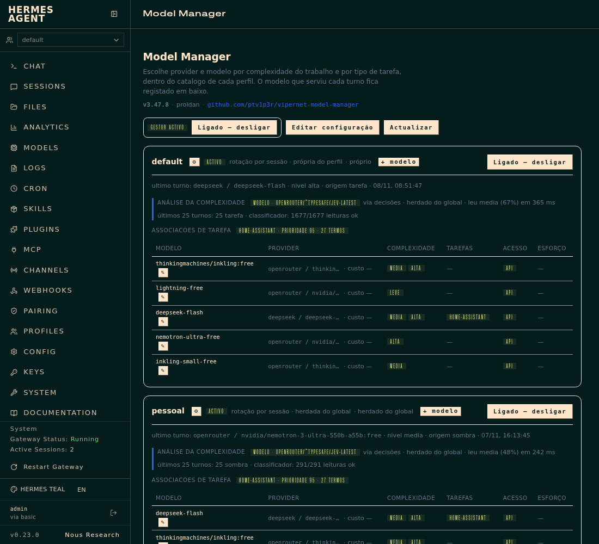
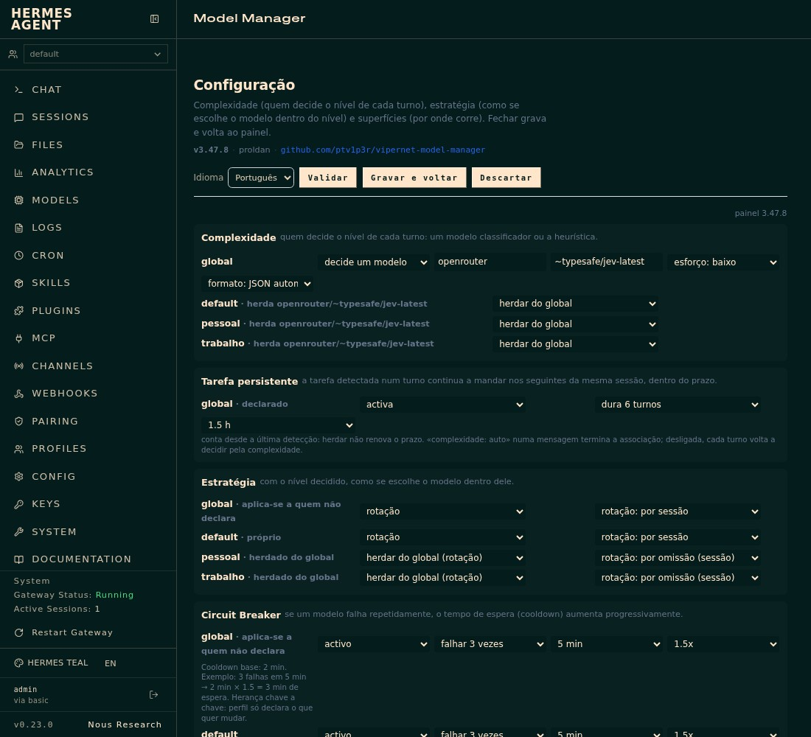
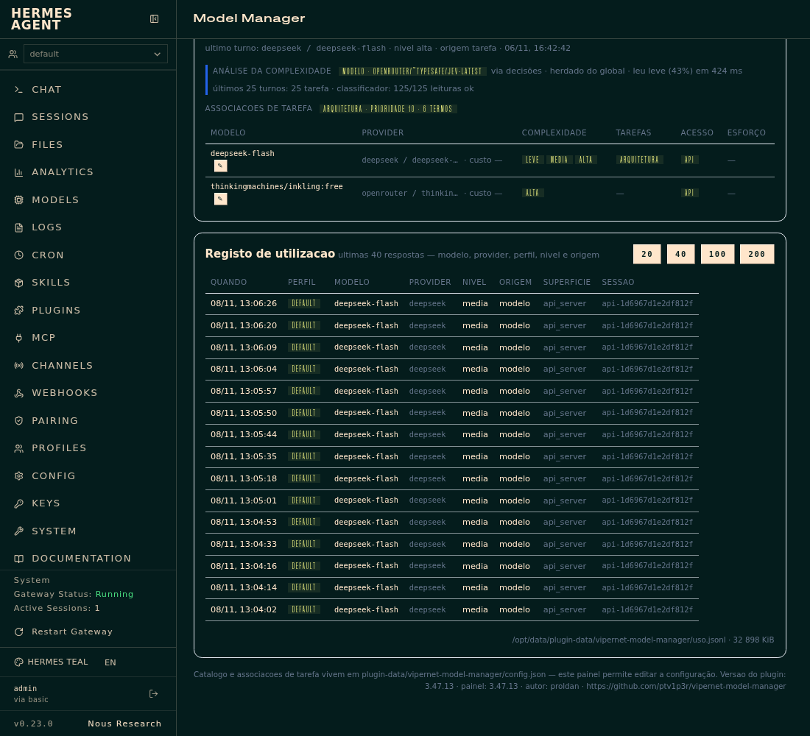

# vipernet model manager

[English](README.md) · **Português**

Escolhe **provider + modelo** em cada turno a partir da complexidade que o turno
mostra — não a partir de uma etiqueta que o dono escreveu — dentro do catálogo
que o dono declarou **para o perfil que está a ser servido**.

**Repositório:** https://github.com/ptv1p3r/vipernet-model-manager — público, e é daqui que o
catálogo instala. O trabalho é feito no espelho privado no Gitea
(`proldan/vipernet-model-manager`), que publica para aqui a cada commit e a cada 8 h.
A entrada de catálogo a submeter vive em `plugin-catalog/vipernet-model-manager.yaml` e pina
um commit que contém este ficheiro.

Três frases que resumem o contrato:

1. A **complexidade é medida** (última mensagem + estado do trabalho): tamanho do
   texto próprio, verbos de engenharia, blocos de código, tracebacks, caminhos,
   turnos e ferramentas usadas. `complexidade: alta` continua a existir como
   override explícito, mas o caminho normal é a análise.
2. O **catálogo é fechado e é do dono**. Fora das entradas declaradas não há
   rotas. Cada entrada diz que níveis de complexidade serve. Uma entrada cuja
   credencial não resolve é saltada, com registo.
3. Cada **perfil** decide se usa o plugin, como usa (estratégia) e com que lista.
   Um perfil ausente da config não é tocado.

## Capturas

O separador **Model Manager** do painel, na `v3.47.8`, capturado de uma instalação viva configurada em português (o painel é bilingue; a entrada de catálogo e este README estão em inglês):

| Captura | O que mostra |
|---|---|
|  | **Visão geral** — estado do gestor, o modelo que serve cada perfil, a sua análise de complexidade e as associações de tarefa. |
|  | **Configuração** — quem decide o nível de cada turno, como se escolhe o modelo dentro do nível, a tarefa persistente e o circuit breaker. |
|  | **Registo de uso** — o que foi servido turno a turno: modelo, provider, perfil, nível, origem e superfície. |

O nome completo do dono está substituído pelo handle público nestas capturas.

## Analise de complexidade (3.5)

Duas vias, e a segunda e opcional:

1. **Heuristica** (sempre disponivel, sem custo): pontua sinais independentes e
   corta em dois limiares — `leve` (< media), `media` (>= 3) e `alta` (>= 6).
2. **Modelo classificador** (opt-in): um modelo escolhido pelo dono responde
   `leve`/`media`/`alta`. Definido globalmente ou por perfil, com interruptor
   proprio em cada ambito. Sem modelo definido, ou com o interruptor em baixo,
   vale a heuristica — o comportamento nao muda.

Ordem de decisao por turno, do mais forte para o mais fraco:
**marcador explicito** (`complexidade: alta` na mensagem) **> associacao de
tarefa > modelo classificador > heuristica**. As tres primeiras fontes so
decidem o nivel; a rota (provider+modelo) sai sempre do catalogo do perfil.

O bloco vive em `analise.classificador` (global) e em
`perfis.<nome>.analise.classificador` (por perfil). O bloco do perfil
**substitui por inteiro** o global — e o que permite a um perfil desligar
(`{"activo": false}`) o que a config global liga. Um perfil que nao declare o
bloco herda-o; e o que se grava nunca e uma copia do global (uma copia fixava o
perfil ao valor do dia e deixava de acompanhar mudancas do global).

```json
"classificador": {
  "activo": true, "provider": "inception", "modelo": "mercury-3",
  "timeout_s": 12.0, "max_tokens": 320, "cache_ttl_s": 600,
  "janela_mensagens": 8, "max_chars": 4000
}
```

**Fail-open por desenho**: erro de rede, `HTTP != 200`, resposta sem um dos tres
niveis, ou `timeout_s` excedido devolvem `None` — decide a heuristica e o motivo
fica em `classificador_erro` no ledger. O disjuntor abre de duas maneiras
diferentes, porque as falhas nao custam o mesmo: **um timeout suspende a
primeira** (custa o `timeout_s` inteiro em latencia do turno, e a heuristica
responde em 0 ms; esperar tres vezes para ouvir o que a primeira ja disse e pagar
3x por nada — medido a 2026-11-03: quatro falhas em 45 s no perfil `pessoal` a
8 s de timeout), e tres falhas de outro tipo (5xx, resposta ilegivel) suspendem
como antes. A resposta e descarregada por `max_tokens` (320) e a mesma ultima
mensagem nao e paga duas vezes dentro de `cache_ttl_s`.

**Uma falha e uma falha, nao uma por pedido do turno**: o nivel fica pinado no
turno, e o erro tambem. So o evento do primeiro pedido carrega
`classificador_erro`; os seguintes levam `classificador_erro_herdado` e nao
contam para a taxa. Sem isto, um turno de 14 pedidos (medido a 2026-11-03, perfil
`default`) aparecia como 14 falhas no cartao e na contabilidade.

**Orcamento de saida e modelos de raciocinio** (medido 2026-11-02): o
`deepseek-flash` pensa antes de responder. Com `max_tokens: 12`, os 12 tokens de
saida foram todos `reasoning_tokens` e o `content` voltou vazio — o classificador
falhava por orcamento, nao por qualidade. Com 320, a mesma mensagem devolve
`alta` em 1,3 s (196 tokens de entrada, 59 de saida, ~0,00008 USD). Um modelo de
raciocinio cortado a meio ainda entrega o nivel: quando o `content` vem vazio,
le-se o `reasoning_content` e vale o ultimo nivel que o modelo escreveu.

Ligar/desligar, sem editar JSON:

```sh
vmm classificador                            # estado efectivo por perfil
vmm classificador on --provider inception --modelo mercury-3
vmm classificador off --perfil pessoal       # desliga so neste perfil
vmm classificador on --perfil trabalho --provider openrouter --modelo x/y
```

**O provider do classificador tem de existir no perfil servido** (medido
2026-11-03). O classificador resolve-se com o `config.yaml` do **perfil**, não
com o do processo: um `inception/mercury-3` que funciona no `default` falha no
`pessoal` com `AuthError: Unknown provider 'inception'` enquanto o bloco
`providers.inception` não estiver declarado lá — `hermes -p pessoal config set
providers.inception.{name,base_url,key_env,api_mode,default_model}`, com
`key_env: INCEPTION_API_KEY` e `api_mode: chat_completions`. Um erro destes é
`sem_efeito` com `motivo` e suspensão de 1 h, não falha transitória: não abre o
disjuntor nem conta para a taxa. A chave vem das fontes de segredos para o
processo do gateway, não do `.env` do perfil.

Estado actual: o global é `inception/mercury-3` e os três perfis herdam-no. Um
perfil que queira outro modelo declara o seu próprio bloco — a partir daí fica
`próprio do perfil` e deixa de acompanhar o global, que é o preço de não ter uma
cópia a fingir de herança.

No painel, a seccao **Analise da complexidade** (dentro do editor) tem uma linha
por ambito — global e cada perfil — com tres estados por perfil: *herdar do
global*, *desligado (heuristica)* e *decide um modelo* (com provider e modelo).
Grava pelo mesmo `/config`, depois de validado.

Sinais da heuristica e o que os separa:

- **Verificar nao e analisar.** "testa o plugin", "adiciona um teste" — o verbo e
  confirmacao, nao trabalho de analise; `_ANALISE` ignora verbos de verificacao.
- **Manutencao separada de trabalho.** `corrigir`, `adicionar`, `atualizar` e
  `revisar` valem 3 (`manutencao`), nao 5 (`trabalho`) — um typo no README nao
  compra um modelo caro. Mas se o alvo for **sistema vivo** (automacao, servico,
  instalacao, container), volta a valer `trabalho`: e producao, nao manutencao fina.
- **Planeamento e relatorio tem categoria propria.** `planeamento` (5): plano,
  janela, rollback, proposta de migracao. `relatorio` (3): resumo/relatorio
  recorrente, que produz mas e barato.
- **Diagnostico baixou de 6 para 4** (`auditoria`): "porque o inversor nao liga"
  e trabalho de analise, mas nao do peso de uma decisao de arquitetura (6).

Medicao que fixou os limiares (2026-11-02, dois holdouts, 42 casos):

| variante | holdout1 (24) | holdout2 (18) | total |
|---|---|---|---|
| `media=3` (em vigor) | 24/24 | 17/18 | **41/42 (98%)** |
| `media=4` | 20/24 | 14/18 | 34/42 (81%) |
| `media=3` + regra dos 2 sinais | 21/24 | 14/18 | 35/42 (83%) |

A regra dos dois sinais (`media_sinais: 2`) fica implementada e **inactiva**: so
actua quando a chave existe nos limiares. `test_holdout.py` versiona o holdout2
com baseline 17/18 — o unico erro conhecido ("NPM ou Traefik, justifica") e
discutivel no rotulo e **nao se calibra contra ele**.

## v4.3 — o que separa agora

Correccoes de conceito, cada uma nascida de um caso real falhado:

- **`justificacao` (3)**: "justifica" pede razao, nao desenha. Antes valia 6 e
  mandava "NPM ou Traefik? justifica" para o modelo caro.
- **`explicacao_conceito` (2)**: "explica como funciona X" e raciocinio de
  dificuldade media.
- **`avaria_de_servico` (+3)**: sintoma sobre um processo que devia estar a
  correr (`_SERVICO_AVARIADO`). Uma lampada que nao acende nao e isto.
- **Objecto vivo restrito**: sairam `ha`, `bateria`, `inversor`, `dashboard` e
  `api`. `ha\b` casava com o verbo portugues "ha" (texto normalizado sem
  acentos) e promovia um typo a trabalho de producao.
- **Verbos genericos** (`prepar`, `gera`, `faz`, `produz`): herdam o peso do
  objecto; "gera o relatorio mensal" e relatorio (3), nao engenharia (5).
- **`mudar` em pergunta nao e ordem**: so `muda`/`mude` contam como manutencao.
- **Vocabulario de infra**: `lxc`, `proxmox`, `portainer`, `backup`, `retencao`,
  `snapshot`, `vlan`, `skills`, `n8n`, `sqlite`, `postgres`, `firmware`,
  `ota`, `consumo`, `standby`, `energia`, `seguranca`, `exposicao`, `homelab`.

### Protocolo de medicao (importante)

Os holdouts `test_holdout{,2,3,4}.py` somam 79 casos. Cada vez que se afina o
vocabulario contra um deles, esse conjunto **deixa de ser amostra independente**.
A ordem que se cumpriu: medir cego, corrigir conceitos, medir num conjunto novo.

| conjunto | casos | antes da v4.3 | depois |
|---|---|---|---|
| holdout2 | 22 | 22/22 (treino) | 22/22 |
| holdout3 (cego na altura) | 20 | 12/20 (60%) | 20/20 |
| holdout4 (cego na altura) | 19 | **11/19 (57%)** | 19/19 |

O numero honesto e o **57% cego**, nao os 100%. As 8 falhas eram todas de
vocabulario — nenhuma de limiar — e e por isso que o gargalo do classificador
nao e o `media`, e sim o alcance lexical. Uma frase nova com palavras que nao
estao nas regexes cai em `leve`. O caminho para sair disto nao e mais regex:
e um classificador que generalize (modelo local pequeno ou um modelo gratuito
de contexto grande a responder `leve|media|alta`).


## Painel no dashboard (3.3)

O plugin traz um painel próprio no dashboard do Hermes, na tab **Model Manager**
(`/model-manager`). Fica em `dashboard/`:

| ficheiro | papel |
|---|---|
| `manifest.json` | declara a tab (`position: end`), o `entry`, o `css` e o `api` |
| `api.py` | backend montado em `/api/plugins/vipernet-model-manager/` |
| `dist/index.js` | IIFE que usa `window.__HERMES_PLUGIN_SDK__` e `__HERMES_PLUGINS__.register` |
| `dist/style.css` | geometria do painel (cores e tipografia vêm do tema do host) |

O painel mostra, por perfil: o interruptor, a estratégia, o **indicador da análise
de complexidade**, as associações de tarefa, o catálogo com a complexidade e o
esforço de cada modelo, e o último modelo servido; em baixo, o registo das últimas
respostas (quando, perfil, modelo, provider, nível, origem, superfície, sessão).

Escreve o interruptor (global ou por perfil) e a configuração inteira (editor JSON,
`POST /config`, com `POST /validar` antes), sempre por `gestor.gravar` — validação,
backup e `os.replace`, com releitura independente antes de responder OK. O log é
leitura.

O host descobre painéis por `<plugins root>/<nome>/dashboard/manifest.json`; a cache
de descoberta do processo do dashboard **não** se invalida sozinha quando aparece um
painel novo — depois de instalar, reiniciar o contentor do dashboard (ou forçar
`/api/dashboard/plugins/rescan`). Os ficheiros de `dist/` são servidos do disco a
cada pedido: mudam com um refresh do browser, sem reiniciar nada (medido: sha256 do
asset servido igual ao do ficheiro local). O `api.py` é outra história: entra quando
o backend do painel carrega o módulo — no arranque do contentor e na recarga do
plugin (`reload_gateway_plugins`, por perfil num gateway multiplexado). Não se
distingue qual dos dois valeu por `curl`: `/api/plugins/<nome>/*` responde `401` do
gate de sessão a pedidos de fora, com ou sem basic-auth, pelo que a verificação do
backend se faz pelo caminho autenticado (o painel no browser) ou em processo, com o
mesmo ficheiro. A config do agente é lida a quente (TTL 5 s).

### Identidade no cabeçalho (3.13.8)

O cabeçalho mostra `v<versão> · <autor> · github.com/<conta>`, com o repositório
como ligação. A versão **não** é uma cópia escrita no JS: `GET /estado` devolve
`plugin` com `versao` lida do `plugin.yaml` — o mesmo ficheiro que o loader e o
catálogo leem —, `autor` e `github`. Se o `version` do `manifest.json` divergir do
`plugin.yaml`, o cabeçalho mostra os dois números a vermelho em vez de escolher um
em silêncio: foi essa divergência (painel 3.11.2 com o disco em 3.11.3) que já fez
duvidar de que código estava a correr.

`github` é o repositório público do autor, e não o Gitea interno: o catálogo exige
um repositório público clonável por https em GitHub ou GitLab [1], pelo que o
endereço que o painel mostra é o que serve uma submissão.

### Indicador da análise por cartão (3.7)

Cada cartão de perfil responde a uma pergunta só: **a complexidade deste turno está
a ser decidida por um modelo — e qual — ou pela heurística?** A barra à esquerda e o
chip dizem o modo; o texto diz o resto:

| o que se vê | significado |
|---|---|
| `modelo · inception/mercury-3` + `esforço baixo · herdado do global` | o perfil não declara bloco e usa o global |
| `modelo · inception/mercury-3` + `próprio do perfil` | o perfil declara o seu próprio classificador |
| `heurística` + `classificador desligado — decide a heurística` | existe bloco, mas `activo: false` |
| `heurística` + `classificador sem efeito (…) — decide a heurística` | bloco declarado que não passa a validação |
| `heurística` + `sem modelo definido` | ninguém declarou nada, em nenhum âmbito |
| `últimos N turnos: 22 modelo · 3 heurística` | evidência do ledger, não da config |
| `⚠ o modelo falhou no último turno — caiu na heurística: …` | o classificador está ligado mas falhou |

As duas últimas linhas são o que distingue **declarado** de **a decidir**: um
classificador ligado que erra cai na heurística em silêncio, e a config continuaria a
dizer "ligado". A contagem vem dos eventos `resposta` do perfil (últimos 25) e o
motivo do erro do último evento com `classificador_erro`.

Uma só casa para a resposta: `gestor.classificador_efectivo(cfg, perfil)` — usada
pelo cartão (`/estado`) e pelo `vmm classificador ver`. Resolve a herança e a
validação; o painel não reimplementa nenhuma das duas.


Auto-teste do painel (não toca na config viva):

```sh
VMM_DIR=$(mktemp -d) /opt/hermes/.venv/bin/python dashboard/selftest.py
```

## Instalação

```sh
ln -sfn /opt/data/plugins/vipernet-model-manager/cli.py /opt/data/bin/vmm
hermes plugins enable vipernet-model-manager            # no perfil que o deve usar
hermes -p pessoal  plugins enable vipernet-model-manager
hermes -p trabalho plugins enable vipernet-model-manager
```

`hermes plugins enable` recarrega o gateway sozinho. A config é lida a quente
(cache de 5 s), portanto editar o catálogo **não** exige reiniciar nada.

## Config

Ficheiro vivo: `/opt/data/plugin-data/vipernet-model-manager/config.json`
(override por `VMM_DIR`, útil para ensaios). Esquema:

```json
{
  "versao": 3,
  "activo": true,
  "registar": true,
  "analise": {"janela_mensagens": 8, "varredura_max_mensagens": 60,
               "limiares": {"media": 3, "alta": 7}, "descer_apos": 2,
               "fixar_nivel_por_turno": true},
  "estrategia": {"modo": "rodizio", "por": "sessao"},
  "perfis": {
    "trabalho": {
      "activo": true,
      "estrategia": {"modo": "prioridade"},
      "analise": {},
      "catalogo": [
        {"id": "deepseek-flash", "provider": "deepseek", "modelo": "deepseek-flash",
         "complexidade": ["leve", "media"], "acesso": "api"},
        {"id": "gpt-sol", "provider": "openrouter", "modelo": "openai/gpt-6.1-sol",
         "complexidade": "media", "acesso": "api"},
        {"id": "gpt-sol-sub", "provider": "openai-codex", "modelo": "gpt-6.1-sol",
         "complexidade": "media", "acesso": "subscricao"}
      ]
    }
  }
}
```

- `activo` (topo) — interruptor global; `registar` — escrever o ledger.
- `perfis.<nome>.activo` — interruptor daquele perfil.
- `estrategia` — bloco `{modo, por}`, **lista fechada**, global no topo e
  herdada por cada perfil: `modo` é `rodizio` (alterna dentro do nível) ou
  `prioridade` (primeira entrada elegível da lista); `por` é `turno` ou
  `sessao` e só governa o `rodizio`. Um perfil declara **só o que quer mudar**
  (o delta) e o resto vem do global; sem bloco nenhum, herda. Ver
  «Estratégia: lista fechada com herança».
- `complexidade` por entrada: `"leve"`, `["leve","media"]`, `["alta"]`… Níveis:
  `leve`, `media`, `alta`.
- `acesso` por entrada: `api` ou `subscricao`. **Explicito ou inferido do
  provider** (openai-codex → `subscricao`, os restantes → `api`); é rótulo +
  validação + registo, nunca reescreve `provider`/`modelo`. Incompatibilidades
  (`subscricao` com provider que não openai-codex, ou `api` com openai-codex)
  são recusadas.
- `provider` por entrada: **texto livre com sugestões**, não uma lista fechada
  (desde a 3.47.9). O formulário oferece os providers que a configuração já usa
  e os que o núcleo do Hermes serve (`opcoes.providers_conhecidos`, 49 medidos a
  2026-11-08), mas um nome fora das duas listas é escrito como está e gravado.
  Antes disso o campo era lista fechada e não havia caminho para criar a
  **primeira** rota de um provider que o perfil ainda não usava — o backend
  nunca a recusou. O nome continua a ter de ser servido **naquele perfil**
  (`providers.<nome>` declarado lá, ou um provider de subscrição), senão o turno
  falha com `Unknown provider` — a mesma regra do classificador.
- `analise` do perfil sobrepõe-se ao global chave a chave (limiares, janela,
  `descer_apos`).
- Perfil `"*"` serve de omissão para perfis não listados; um perfil exacto ganha
  sobre o `*`.
- Sem perfil na config e sem `*`: **não gerido** — o turno segue intacto.

### Política do nível `alta` (decisão do dono, 2026-11-03)

O nível `alta` resolve a **`deepseek/deepseek-flash` nos três perfis**, e é a
única rota de `alta` declarada no catálogo. A consequência tem de ser lida antes
de mexer: **não existe no catálogo um modelo acima do flash**, logo `alta` não
significa «modelo melhor» — significa «o modelo pago, sem descer aos free». O
ganho do classificador é de **custo, não de qualidade**: em `leve`/`media` a rota
pode rodar para um modelo free; em `alta` não desce.

Quem editar o catálogo, duas regras:

- **Não acrescentar `alta` a outra entrada sem decisão explícita do dono.** Se um
  modelo free declarar `alta`, o rodízio passa a poder servir `alta` com um free e
  o nível deixa de garantir o flash. Foi o que aconteceu antes de 2026-11-03: 224
  eventos de `alta` servidos por `thinkingmachines/inkling:free` no ledger, todos
  com `motor` ausente (histórico anterior ao marcador), e zero depois.
- **`deepseek-v4-pro` está proibido** (decisão do dono, 2026-11-03) — fora do
  catálogo, fora dos catálogos por omissão do `gestor.py` e fora do juiz de
  `eval/aprender.py` sem `--juiz-permitir-v4-pro` (guard que devolve rc 2).

Se `deepseek` falhar, `alta` não tem segunda rota: a degradação desce um nível e
o turno segue num modelo de `media`, com `degradado_de` no ledger. É o
comportamento desejado — mas é uma dependência de um só provider, e deve ser
lembrada quando se decidir o catálogo.

### O `state` do transporte de decisões e o piso de confiança (3.14.2)

Medido a 2026-11-03 sobre os 250 casos do gold, com o `~typesafe/jev-latest`.
A conclusão muda a política: **o que estava a estragar o Jev não era a rubrica,
era o `state` — e o piso de confiança não compra qualidade nenhuma.**

O que o plugin enviava era o transcrito do `texto()`: sete mensagens anteriores
de outros assuntos (até 400 chars cada) mais o pedido, 4 000 caracteres no total.
Numa sessão real as anteriores são pedidos de outros temas, e o modelo passa a
julgar o conjunto. Medido, na mesma rubrica:

| `state` | kappa | kappa `alta` | precisão `alta` | confiança p50 |
|---|---|---|---|---|
| transcrito de produção (7 anteriores) | 0,4007 | 0,3604 | 0,339 | 0,47 |
| transcrito + bloco de medidas | 0,4935 | 0,5479 | 0,525 | 0,57 |
| **medidas + duas anteriores rotuladas (publicado)** | **0,5094** | **0,6349** | **0,667** | **0,655** |
| medidas + pedido isolado | 0,4666 | 0,6591 | 0,677 | 0,72 |

O `state` publicado passa a ser `[MEDIDAS DO PEDIDO]` (caracteres, linhas, tokens
estimados, artefactos colados — factos verificáveis, sem os interpretar) +
`[CONTEXTO ANTERIOR, NÃO É O PEDIDO A CLASSIFICAR]` com no máximo **duas**
anteriores cortadas a 300 chars + `[PEDIDO A CLASSIFICAR]`. Fica em ~490 chars
em vez de 4 000: mais barato, mais rápido e mais certo. A chave é
`analise.classificador.estado` (`medidas` por omissão, `simples` para voltar ao
transcrito sem reverter código).

As medidas são neutras de propósito. Não dizem «âmbito aberto: sim» nem «parece
complexo» — os dois vícios medidos nos juízes foram exactamente ler âmbito aberto
e comprimento como nível.

**O piso.** Em produção, com o transcrito, **127 de 129 leituras abstiveram**
(`confianca_baixa`), confiança p50 **0,18**, e o modelo nunca leu `media` — só
alternava entre `leve` e `alta`. Com o `state` novo a confiança sobe (p50 0,655) e
o piso passa a ser uma escolha, não uma necessidade. E a escolha medida é
surpreendente — a cascata «modelo acima do piso, heurística abaixo»:

| piso | turnos decididos pelo modelo | acerto | kappa `alta` | altas falsas |
|---|---|---|---|---|
| **0,00** | 250/250 | **0,700** | 0,6349 | **10** |
| 0,40 | 184/250 | 0,692 | 0,6098 | 23 |
| 0,70 | 115/250 | 0,632 | 0,5072 | 34 |
| 0,90 | 48/250 | 0,588 | 0,4079 | 45 |

(heurística sozinha, no mesmo corpus: **0,564** de acerto.)

Subir o piso **piora** o acerto e aumenta as altas falsas, porque abster devolve
o turno à heurística, que sobrestima `alta` (precisão ~0,45). O piso foi
desenhado para poupar quando o modelo está inseguro; medido, o modelo inseguro
continua a ser melhor juiz do que o fallback. Por isso o `confianca_min` do
transporte de decisões fica em **0,0**: a abstenção passa a servir só o que devia
servir — falha de transporte, resposta fora dos níveis, rota suspensa — e não a
mera incerteza. Quem quiser poupar chamadas pode usar 0,40 (perde 0,008 de
acerto e corta 26% das decisões).

### Qualquer modelo como classificador (3.15.0)

Até 3.14.2 o classificador assumia um provider com `/chat/completions`, corpo
`{model, messages, temperature, max_tokens}`, credencial na rota e um modelo que
aceita `response_format`. Isso excluía três famílias reais: os modelos de
decisões (`~typesafe/...`), os de raciocínio (o1/o3/gpt-5 recusam `temperature`
com 400) e os que mudam o nome do orçamento de saída. A 3.15.0 fecha as sete
lacunas com configuração, sem código por provider — a config do perfil continua a
ser a única casa.

| chave | omissão | para que serve |
|---|---|---|
| `via` | `auto` | `chat`, `decisoes` ou `auto`. `auto` sonda o chat e muda sozinho |
| `preset` | `""` | `""` infere pelo id; `padrao`, `sistema-um`, `raciocinio`; `nenhum` desliga |
| `estado` | `medidas` | `medidas` (bloco de factos) ou `simples` (transcrito, rollback) |
| `temperatura` | `0.0` | `null`/`omitir`/`-` = **não enviar** o campo |
| `top_p` | `1` | omitido quando a temperatura é omitida |
| `max_tokens_campo` | `max_tokens` | `max_completion_tokens` nos modelos recentes da OpenAI |
| `caminho` | `""` | substitui o caminho do chat preservando esquema/host da rota |
| `caminho_decisoes` | `""` | idem, para o endpoint de decisões |
| `parametros_extra` | `{}` | campos extra no corpo; **não** pode trocar `model` nem `messages` |
| `headers_extra` | `{}` | cabeçalhos extra, aplicados depois dos defaults |

**O preset é uma pista, não uma prisão.** Entra por baixo do que o perfil declara
(`{**PRESETS[preset], **bruto}`), logo o valor escrito pelo dono ganha sempre. O
`preset: ""` infere pelo id do modelo — `~typesafe/` é System One, `o1`/`o3`/`gpt-5`
são raciocínio — e `nenhum` desliga a inferência para quem quiser o comportamento
cru.

**`via: auto` é o default porque apontar a um modelo não devia exigir saber o tipo
dele.** Tenta o chat; se o provider responder que é um *decisions model*, memoriza
a descoberta por alvo (perfil+provider+modelo) **em memória** — não na config, para
não confundir o que o dono declarou com o que o plugin aprendeu — e repete o pedido
no endpoint certo. A sonda custa uma chamada recusada, uma vez por processo.

**Duas redes de segurança, porque os providers não são coerentes.** Um 400 que
mencione `temperature`/`top_p` retira o campo e repete **uma vez**, sobre uma cópia
local da definição (não suja a definição do chamador). E um 400 que mencione
`decisions model`/`/api/alpha/decisions` é levantado de imediato — antes da
degradação de `response_format`, que de outro modo consumia a resposta e escondia a
causa.

Provas vivas contra o OpenRouter (2026-11-03, `~typesafe/jev-latest`):

| prova | configuração | resultado |
|---|---|---|
| preset inferido | só `modelo`, mais nada | 1 pedido a `/api/alpha/decisions`, `alta`, 0,96, 292 ms |
| sonda `auto` | `preset: nenhum`, `via: auto` | `chat` → 400 → `/api/alpha/decisions`, `alta`, 0,96, 390 ms |
| LLM de chat | `gemini-2.5-flash`, `via: auto` | 1 pedido a `/chat/completions`, fica no chat |

**O painel deixou de enumerar chaves.** O `baseDoBloco` reconstrói o bloco a partir
do que lá está e remove só os campos vazios — com `temperatura` de fora, porque
`null` ali significa «não enviar». A lista fixa de chaves tinha apagado
`timeout_s`/`max_tokens`/`janela_mensagens`, depois `via`/`estado`/`confianca_min`,
e apagaria agora `preset`/`temperatura`/`parametros_extra`: mudar o provider no
painel não pode ser uma armadilha.

### Juiz do ciclo de aprendizagem

O juiz que rotula o corpus de treino é **`inception/mercury-3`** (decisão do dono,
2026-11-03): alinha com o classificador e tira o deepseek de todas as funções do
ciclo. `--juiz-provider deepseek` continua disponível como alternativa, e o
`deepseek-v4-pro` continua bloqueado pelo guard de rc 2. O juiz **não** decide o
nível de nenhum turno — só rotula o corpus — e não é o mesmo que o modelo da
resposta.

Duas coisas medidas, que quem mexer aqui tem de saber:

- **O `mercury-3` limita pedidos por minuto.** Medi a 2026-11-03: 130 casos um a
  um com 4 threads deram `HTTP 429 too many requests per minute`, e a corrida
  seguinte devolveu **0/130** — o limite é por minuto e o arranque em rajada
  esgota-o. Vinte pedidos espaçados de 3 s passam todos. Por isso o juiz rotula
  **em lotes de 10** (`_etiquetar_lote`, `--juiz-lote`, por omissão 10 quando o
  provider é `inception`): 13 pedidos, 130/130 respondidos em todas as corridas,
  ~100 s. Um 429 espera e repete o **mesmo** lote; tratá-lo como falha definitiva
  apagava o corpus e o portão fechava por falta de casos comuns, não por
  discordância.
- **O `mercury-3` ainda não tem autoridade de juiz.** Kappa contra os 130 rótulos
  do gold, em 5 corridas: fronteira `alta` **0,443 / 0,490 / 0,479** (esforço
  baixo) e **0,506 / 0,450** (médio); fronteira `baixa` 0,587 / 0,517 / 0,452 e
  0,517 / 0,617. O portão exige **0,60** por fronteira operacional. Fica abaixo
  em todas as corridas, e a precisão da classe `alta` (0,38–0,43) mostra o erro:
  chama `alta` a pedidos que o gold rotula `media`. O `deepseek-flash` media
  0,599–0,631 em `alta` e 0,483–0,545 em `baixa`, com estabilidade 0,877 contra
  0,754–0,808 do mercury. **Nenhum dos dois passa o portão**: o bloqueio real é o
  gold (40 rótulos humanos, 2 de `alta`), não a escolha do juiz.

#### Acordo de lotes: tentado, medido, rejeitado (3.13.9)

A hipótese era que o erro do juiz fosse **ruído** — casos isolados que uma
votação cancelaria. O mecanismo está implementado e testado (`--juiz-votos N`,
`--juiz-acordo-min`, `--so-calibrar`), mas a medição de 2026-11-03 diz que a
hipótese é falsa.

Três passagens sobre os mesmos 130 casos do gold, baralhadas entre passagens para
a composição do lote não repetir o mesmo erro, agregadas por maioria 2-de-3:

| | passagem 1 | passagem 2 | passagem 3 | maioria 2-de-3 |
|---|---|---|---|---|
| kappa global | 0,4659 | 0,5068 | 0,4659 | **0,4697** |
| `alta` | 0,4878 | 0,5340 | 0,5144 | **0,5040** |
| `baixa` | 0,4728 | 0,5409 | 0,4388 | **0,4693** |
| precisão `alta` | 0,421 | 0,447 | 0,436 | **0,425** |

A maioria ficou **abaixo da média das passagens** (0,504 contra 0,512 em `alta`)
e a precisão de `alta` não se moveu (0,421–0,447 nas passagens, 0,425 na
maioria). E os dois números que explicam tudo:

- **Cobertura 98,5%** — só 2 dos 130 casos ficaram sem maioria. O juiz não hesita;
  ele discorda do gold com convicção.
- **Acordo interno 82% na fronteira `alta`** contra **precisão 0,425** contra o
  gold. Consistência interna alta com validade externa baixa é a assinatura de
  **viés sistemático**, não de ruído: os ~23 casos que ele promove a `alta` sem
  o serem são os mesmos nas três passagens.

Conclusão operacional: votar num único juiz **não** dá autoridade a esse juiz, e
por isso `--juiz-votos` fica em **1** por omissão — o ciclo semanal não paga três
vezes por uma medição que não melhorou. O portão passou a exigir **cobertura
mínima** (`--cobertura-minima`, 0,85) exactamente para isto: sem esse chão, subir
o kappa descartando os casos disputados comprava autoridade a troca de não
decidir, e os casos disputados são os difíceis.

O caminho que a medição aponta não é repetir o mesmo sinal: é **combinar sinais
independentes** (juiz + score heurístico a concordarem em `alta`, avaliado por
validação cruzada) ou **dar massa ao gold em `alta`** — 17 casos não distinguem
0,43 de 0,60 com margem. Repetir o juiz três vezes não faz nem uma coisa nem
outra.

### Subscrição vs API

A mesma família de modelos tem duas rotas de acesso distintas, e o plugin não
as converte uma na outra:

- **Subscrição ChatGPT/Codex** → `provider: openai-codex`, `modelo: gpt-6.1-sol`,
  `acesso: subscricao`. O transporte é o canal de subscrição (Codex), não uma
  chave de API; sem esse canal autenticado a rota não resolve e é saltada.
- **OpenRouter** → `provider: openrouter`, `modelo: openai/gpt-6.1-sol`,
  `acesso: api`. Usa a chave de API do OpenRouter.

Adicionar a rota de subscrição sem autenticar o canal não a ativa: a entrada
existe, mas `resolver_rota` falha e a middleware salta-a (registo em
`sem_rota`).

## Esforço de raciocínio por rota (3.6)

Cada entrada do catálogo pode declarar `esforco`: `baixo`, `medio` ou `alto`
(a escada do Hermes — `low`/`medium`/`high` — também é aceite, porque o JSON é
editado por três vias e recusar o inglês seria uma armadilha, não uma
validação). O campo é **opcional e não tem valor por omissão**: ausente quer
dizer «não declaro nada», não «médio», para que uma rota que não precisa não
arraste o esforço de outra.

```json
{"id": "flash", "provider": "deepseek", "modelo": "deepseek-flash",
 "complexidade": ["leve", "media"], "acesso": "api", "esforco": "baixo"}
```

Como é aplicado — e porque não é uma linha só:

- **No agente**, em `agent.reasoning_config` (`{"enabled": true, "effort": …}`),
  que é o que governa os turnos seguintes. Chamado **depois** de
  `switch_model`, porque a troca volta a resolver o valor do `config.yaml` e
  apagaria o que fosse posto antes. O valor de origem fica guardado e é
  **reposto** quando a rota seguinte não declara esforço — o agente é o mesmo
  objecto de turno para turno, e sem essa reposição uma rota contaminava todas
  as seguintes.
- **No payload do próprio turno**: o `api_kwargs` é construído **antes** da
  middleware, logo mudar o agente só valeria para o turno seguinte. A escrita
  usa o perfil do provider de destino — o mesmo objecto que o Hermes usa para
  construir o pedido —, pelo que a forma é a do fio certo:
  `thinking` + `reasoning_effort` no deepseek, `reasoning` no OpenRouter, e
  **nada** num modelo sem raciocínio (medido: `deepseek-v3` devolve `({}, {})`).
  Os campos de raciocínio do provider anterior são removidos do payload; sem
  isso, um turno que viesse do OpenRouter levava um `reasoning` que o deepseek
  recusa.
- **No classificador** o esforço entra plano no corpo (é HTTP directo, sem SDK,
  logo `extra_body` não existe ali). Com esforço declarado, o `max_tokens` do
  classificador tem um **piso de 1200**: o raciocínio sai do mesmo orçamento e
  os 320 tokens por omissão podem ser todos gastos a pensar — medido, a primeira
  classificação com `esforco: baixo` falhou com
  `resposta sem nivel reconhecivel (length 320tok)` e caiu para a heurística.

Testado por `selftest.py` (21 verificações novas): vocabulário, validação no
catálogo, forma por provider, limpeza do payload, reposição do valor de origem
e o corpo do classificador.

## Resposta em JSON e classificação em lote (3.9)

O classificador pede a resposta como **objecto JSON** (`{"nivel": "media"}`) em
vez de uma palavra solta, e a configuração tem três valores para `formato_json`:

| valor | comportamento |
|---|---|
| `auto` (por omissão) | pede `response_format: {"type": "json_object"}`; se o provider recusar com **400/404/415/422**, repete **o mesmo pedido sem o campo** e segue |
| `on` | pede sempre; um provider que recuse dá erro, sem segunda tentativa sem formato |
| `off` | nunca pede; só texto (o parse tolerante continua a valer) |

Porque é que `auto` degrada em vez de ter uma lista de providers: uma lista
envelhece a cada modelo novo, e o custo de errar é uma chamada. Os códigos foram
escolhidos — **401/402/429/5xx não se resolvem a retirar um campo**, e esses
falham à primeira.

Medido no `inception/mercury-3` a 2026-11-02, 10 mensagens por variante:

| variante | latência mediana | tokens saída | json limpo | divergências (`length`) | acertos |
|---|---|---|---|---|---|
| **json + esforço baixo** | **665 ms** | **68** | **10/10** | **0** | **9/10** |
| json + esforço médio | 1029 ms | 373 | 9/10 | 1 (aos 4314 ms) | 7/10 |
| texto + esforço médio | 553 ms | 76 | — | 0 | 9/10 |
| texto + esforço baixo | 548 ms | 60 | — | 1 | 9/10 |

Duas conclusões que contrariam o conselho genérico «comece sempre em *medium*»:
neste modelo, **médio é pior** para esta tarefa (cinco vezes os tokens, o dobro
da latência, dois acertos a menos) — é classificação de três classes, não
raciocínio difícil; e o **JSON estabiliza a resposta** (zero divergências contra
uma). O `esforco` do classificador fica, por isso, em `baixo` na configuração
viva, e mudar é um comando.

`forma()` regista no ledger como a resposta veio — `json` (objecto com nível),
`texto` (palavra solta, sujeita a falso positivo por citação do prompt) ou
`raciocinio` (conteúdo vazio, só pensamento). Sem esta distinção, um acerto por
palavra solta parecia igual a um JSON limpo.

### Lote

`classificar_lote()` manda N pedidos num só, com uma lista numerada e uma
resposta `{"niveis": [{"i": 1, "nivel": …}]}`. Serve para medir um corpus
inteiro e para lotes grandes; o turno normal continua a classificar um pedido,
com cache.

```
vmm classificador lote "ola" "explica o cache do nginx" "desenha a arquitetura do AAD"
```

Medido a 2026-11-02 com 8 pedidos reais: **551 ms**, 447→130 tokens, 8/8
acertos, formato json aceite. Com 10 pedidos: 2,5 s contra 6,6 s um a um (2,7×
mais rápido) mas ~1,6× os tokens — o lote paga-se em latência, não em dinheiro.
O orçamento acompanha o lote (`max(1200, 120 × N)`); um lote que volte sem
níveis é repetido uma vez sem formato e sem esforço.

O `_ler_lote` aceita as três formas que um modelo devolve na prática —
`{"niveis":[{"i":N,"nivel":…}]}`, `{"niveis":["leve",…]}` e `{"1":"leve"}` — e
**alinha sempre ao tamanho da entrada**, com `None` no que faltar: quem chama
não tem de adivinhar quantos vieram.

Uma armadilha que já custou uma sessão: o prompt **tem de conter a palavra
`json`**, porque o DeepSeek recusa `response_format: json_object` com
`400 Invalid request: Prompt must contain the word 'json'` — medido. Está
travado por teste.

## Triagem do pedido: janela, modalidade, JSON e latência (3.11)

A análise de complexidade diz **quanto raciocínio** o turno pede. Não diz se o
modelo escolhido *consegue* servir o turno. Um `leve` com 200 páginas anexadas
continua a ser `leve` na pontuação e não cabe em nenhuma janela de 32k; um
pedido com uma fotografia não se resolve num modelo só de texto.

A triagem é um filtro de **impossibilidade**, aplicado antes de se tentar a
credencial: cada rota pode declarar o que consegue, e o que ela declarou não
conseguir nunca é tentado. Uma rota que não declara nada é permissiva — declarar
é o que dá a garantia, não declarar não proíbe. A única proibição explícita é
`json_nativo: false`.

| campo da rota | tipo | efeito |
|---|---|---|
| `contexto_max` | inteiro > 0 | recusa quando a estimativa de entrada excede a janela |
| `modalidades` | lista de `texto`, `imagem`, `audio`, `ficheiro` | recusa quando o pedido traz uma modalidade que não está na lista |
| `json_nativo` | booleano | `false` recusa pedidos com `response_format` json |
| `latencia_p95_ms` | inteiro > 0 | recusa quando excede `latencia_max_ms` do perfil |

O que o pedido exige é medido em `analise.necessidades()`:

- **tokens de entrada** — estimativa de 4 caracteres por token sobre todas as
  mensagens; serve para decidir se cabe, não para faturar;
- **modalidades** — detetadas nas partes de `content` (`image_url` → imagem,
  `input_audio` → áudio, `file`/`document` → ficheiro);
- **JSON** — só quando o pedido traz `response_format` de tipo `json_object` ou
  `json_schema`. Falar de JSON não é exigir JSON, e o teste fixa esse negativo.

Três consequências, todas com teste:

1. **Texto grande sobe o nível.** Passando `contexto_grande_tokens` (24 000 por
   omissão), um `leve` é promovido a `media` e o ledger regista
   `triagem: contexto Ntok`. Não é "mais complexo" — é maior do que cabe.
2. **Descer de nível não resolve capacidade.** Se a rota do nível não cabe,
   `degradar_nivel` desce e volta a filtrar; se nada no nível couber, e só
   então, `escolher_por_janela` procura em todo o catálogo a rota viável com
   maior `contexto_max` e o ledger regista `escolhido_por_janela`. Um nível
   *vazio* (sem rota, ou sem credencial) **não** dispara este recurso: aí a
   resposta certa é não trocar, e o `selftest` trava isso.
3. **A recusa fica registada.** A rota preterida aparece no evento `troca` como
   `preteridas: ["id:inviavel:<razão>"]` — `contexto 128003>32000`,
   `sem modalidade: imagem`, `sem json nativo`, `latencia 3000>1500` — em vez
   de desaparecer; no evento `sem_rota` a mesma lista chama-se `falhadas`.

```json
{"id": "janela-grande", "provider": "openrouter", "modelo": "openai/gpt-6.1-sol",
 "complexidade": ["alta"], "contexto_max": 1000000,
 "modalidades": ["texto", "imagem"], "json_nativo": true, "latencia_p95_ms": 2500}
```

**Ordem determinística entre candidatos do mesmo nível (3.22, precedência corrigida em 3.23).**
Quando o nível tem várias rotas, elas são ordenadas antes de qualquer escolha pela
chave `ordem` → `custo` → `id`. A `ordem` declarada **manda sobre o custo**: sem
essa precedência um pago nunca podia ser escolhido à frente de um gratuito, por
muito que o dono o escrevesse na config — e `ordem` seria decorativa. Uma rota
que declara `ordem` ordena antes da que não declara. Dentro do mesmo patamar,
uma rota sem `custo` declarado **não vale zero**: ordena depois das que declaram
custo, porque tratar o desconhecido como grátis faria o não-medido ganhar a
todos os pagos. O `id` fecha o empate por ordem lexicográfica, único e estável:
a sequência em que as entradas aparecem no JSON **nunca** conta. O custo é o
preço por milhão de tokens (`0` é grátis, número igual ou maior que zero);
`ordem` é um inteiro, começando em 1, para declarar a preferência. A rotação
continua a ser `md5(perfil|sessao|nivel) % n` sobre a lista já ordenada: `por:
sessao` mantém a sessão presa ao mesmo modelo dentro do nível. Em
`modo: prioridade` a escolha é o primeiro da lista ordenada — é o modo em que a
`ordem` determina a rota servida, e não apenas a sequência de onde a rotação
parte; em `rodizio` a ordem define o conjunto e a sequência, e o índice do hash
escolhe dentro dele.

**O que não está feito, e não se afirma:** medir TTFT (só existe
`latencia_p95_ms` declarada, não medida), o custo não é lido de nenhuma API (é
declarado à mão e não se atualiza sozinho), a rotação ainda é módulo — uma
entrada acrescentada ou removida reindexa as sessões e troca-as de modelo no
primeiro turno — e reaproveitar decisões para perguntas *semelhantes* (o cache
do classificador é por texto normalizado e `cache_ttl_s`; semelhança difusa
arriscava reutilizar a classificação errada).

## Tarefas por perfil (3.2)

No mesmo JSON, `perfis.<perfil>.tarefas` define como reconhecer cada tarefa;
`catalogo[].tarefas` associa um ou mais tipos de tarefa ao modelo. Exemplo
parcial (acrescentar ao perfil e à entrada já existentes, não substituir o catálogo):

```json
{
  "tarefas": {
    "arquitetura": {
      "termos": ["análise de arquitetura", "SA Analysis", "architecture review"],
      "prioridade": 10
    }
  },
  "catalogo": [{
    "id": "gpt-sol", "provider": "openrouter", "modelo": "openai/gpt-6.1-sol",
    "complexidade": ["alta"], "tarefas": ["arquitetura"]
  }]
}
```

A associação de tarefa ganha à complexidade, aos marcadores e à histerese.
Sem associação, fica a análise anterior. Se nenhuma rota associada resolver
credenciais, tenta a análise por complexidade e regista
`origem=analise_fallback_tarefa`, com `falhadas_tarefa`.
Havendo vários modelos associados usa a estratégia do perfil. Havendo tipos de
tarefa sobrepostos ganha `prioridade` maior; em empate, a frase mais comprida
(e depois o identificador, para desempate determinístico).

A detecção é heurística por frases literais (sem distinguir acentos/maiúsculas),
não um classificador semântico. Só avalia o último pedido do utilizador, sem
memória injectada, mensagens do assistente ou resultados de ferramentas.
Assim uma tarefa nova volta imediatamente à análise, sem herdar a histerese
da associação anterior. Limitação: «continua» sozinho não herda a tarefa;
menções citadas ou negadas à tarefa podem ainda casar com um termo.

`vmm simular trabalho "Faz uma análise de arquitetura"` mostra a tarefa e as
rotas associadas sem chamar providers. O ledger inclui `tarefa` e `origem`;
nenhum texto da conversa é guardado. Regressão: `python3 test_tarefas.py`.
Os identificadores de modelo do exemplo são os da config existente: estes
testes offline não provam disponibilidade nem resposta real do provider.

## Superfícies de sessão (3.16.0)

A superfície é o **contexto** que o core já entrega ao middleware
(`platform`): `cron`, `api_server`, `cli`, `whatsapp`, `telegram`, `discord`,
`subagent`, `tui`, `desktop`, `oneshot`. Não se adivinha por palavras — e é por
isso que é o critério mais fiável dos três.

Medição que justifica não usar `tarefa` para isto: a palavra "cron" aparece em
**33 371 de 435 155 mensagens (7,7%)** do histórico, logo uma regra por `termos`
dispararia em "cronologia" e "crontab". E **59% (273 de 464)** das execuções
`cron` caíam em `alta` sem ninguém a olhar.

**Prioridade:** marcador explícito na mensagem (`complexidade: alta`) >
superfície > associação de tarefa > análise de complexidade. A superfície é
determinística; a tarefa é adivinhada; a análise é estimada.

```json
{
  "analise": {
    "superficies": {
      "cron":       { "entrada": "deepseek-flash" },
      "api_server": { "nivel": "media" },
      "cli":        { "provider": "deepseek", "modelo": "deepseek-flash" }
    }
  }
}
```

Só **três** formas de regra são aceites na gravação:

| Forma | Efeito |
|---|---|
| `{"entrada": "<id do catálogo>"}` | preferida: `acesso`, `esforco` e limites vêm do catálogo — um só sítio de verdade |
| `{"provider": "...", "modelo": "..."}` | atalho; exige que o par exista no catálogo do perfil |
| `{"nivel": "leve\|media\|alta"}` | fixa o nível e deixa o catálogo escolher a entrada |

Qualquer outra forma é **recusada no save**, com o nome da superfície e do id.
Uma regra que aponte para uma entrada que o perfil não tem também é recusada:
resolveria para nada e o turno cairia na análise em silêncio.

`superficies` vive em `analise` (global, herdado por todos os perfis) ou em
`perfis.<perfil>.analise.superficies` (sobrepõe). Um perfil anula uma regra
herdada com `{"activo": false}` sem a apagar do global. Só se grava a cópia do
perfil quando difere do global.

Uma regra com `entrada` fixada é uma **ordem**, não uma preferência: só cede a
capacidade (`excecao: capacidade`) ou a uma rota que falhou há menos de 120 s
(`excecao: rota`). Ambos ficam no ledger como `excecao_motivo:
superficie:<nome>:<motivo>` — sem isso parecia que a regra nunca disparava.

```sh
vmm superficie list                 # todos os perfis, com a origem de cada regra
vmm superficie list default
vmm superficie add default cron entrada:deepseek-flash
vmm superficie add pessoal cli nivel:leve
vmm superficie rm default cron
```

`vmm superficie add` aceita `entrada:<id>`, `nivel:<leve|media|alta>` ou
`provider/modelo`. O painel mostra as regras no cartão do perfil com a marca
`· global` quando são herdadas.

**Registo:** cada evento de troca leva `superficie`, `superficie_fonte`
(`kwarg` ou `agente`) e — quando a regra dispara — `origem: "superficie"`.
O campo `plataforma_kw` guarda o que o core entregou, para distinguir «não há
regra» de «o kwarg não chegou». Diagnóstico opt-in com `VMM_DEBUG_SUP=1`
escreve `debug-sup.jsonl` no directório do plugin.

Regressão: `python3 test_superficies.py` (32 verificações: validador, gravação,
herança superfície a superfície, prioridade e capacidade).

## Superfícies de sessão no painel (3.18.0)

Uma superfície é o contexto em que a sessão corre — `cron`, `api_server`, `cli`, `whatsapp`,
`subagent`, `oneshot`… — e chega ao plugin pelo `platform` que o core passa ao middleware. Não se
adivinha pelo texto: **`cron` aparece em 7,7% das mensagens** (33 371 de 435 155) porque as pessoas
falam de cronologia e de crontab, e uma regra por palavra-chave dispararia nessas conversas. Por
isso `cron` é superfície, não tarefa.

A regra de superfície decide **antes** da tarefa e **antes** da análise: se o contexto já diz que
este turno é do `cron`, não há nada a classificar. A ordem completa é

```
marcador explícito → superfície → tarefa → complexidade → heurística
```

### No painel

Cada cartão de perfil tem um bloco **Superfícies de sessão**:

* uma linha por superfície já configurada — o nome à esquerda, a rota à direita num `select` nativo;
* as opções do `select` vêm do `/estado` (`opcoes.superficies`, `opcoes.niveis` e o catálogo do
  perfil), nunca de uma cópia em JavaScript;
* `— sem regra (herdar) —` apaga a regra do perfil e volta a herdar o global;
* `nunca: nao tratar esta superficie` grava `{activo: false}`, que anula a herdada **só** naquele
  perfil;
* uma linha `· global` marca as regras que vêm do global, para não se procurar no perfil uma regra
  que lá não está;
* o campo de texto no fim acrescenta uma superfície nova (sugestões em `datalist`) e liga-a logo à
  primeira rota do catálogo, que se muda na linha.

### A rota (`alvo`)

| forma | exemplo | quando |
| --- | --- | --- |
| `entrada:<id>` | `entrada:flash-alta` | preferida — `acesso` e `esforco` vêm da entrada do catálogo |
| `nivel:<nivel>` | `nivel:alta` | quando o mesmo nível serve várias superfícies |
| `provider/modelo` | `openrouter/openai/gpt-6.1-sol` | rota fora do catálogo do perfil |
| `nunca` | — | `{activo: false}`: anular a herdada |
| vazio | — | apagar a regra do perfil |

### Herança, superfície a superfície

O global vale para todos e o perfil só declara o que difere. A herança é **por superfície**, não por
bloco: um perfil que declara `cron` continua a ver a regra global de `cli`. Substituir o bloco
inteiro apagaria regras globais sem ninguém as ter apagado — é o tipo de perda silenciosa que este
plugin já pagou caro noutras chaves.

### Gralhas

A lista de superfícies conhecidas **não** é fechada: um provider novo traz contextos novos e a regra
continua válida. Mas uma gralha evidente (`crom` por `cron`) é recusada com a superfície certa na
mensagem — uma regra que nunca dispara porque o nome está mal escrito é o pior resultado possível,
porque o utilizador fica convencido de ter configurado o `cron`.

### API

```bash
curl -u "$USER:$PASS" -X POST http://<host>:8643/api/plugins/model-manager/superficies \
  -H 'Content-Type: application/json' \
  -d '{"ambito":"perfil","perfil":"default","superficie":"cron",
       "alvo":"entrada:flash-alta","rev":"<rev do /estado>"}'
```

Responde `{ok, ambito, perfil, superficie, regra, rev}` — e `regra` é lida do disco depois de
gravar, não é o que se pediu. `rev` desactualizado dá **409** (o painel recarrega o estado).

## Estratégia: lista fechada com herança (3.17.0)

A estratégia diz **como** se escolhe, dentro do nível, quando há mais do que uma
rota elegível. Ficou com os mesmos dois valores que já existiam, agora num bloco
`{modo, por}` configurável no painel:

| chave | valores | efeito |
|---|---|---|
| `modo` | `rodizio` | alterna entre as candidatas do nível |
| | `prioridade` | usa sempre a primeira elegível da lista |
| `por` | `turno` | a roda avança a cada turno (a lista dobra de utilidade, mas invalida a cache do provider) |
| | `sessao` | a roda mantém-se dentro da sessão |

**Lista fechada, por decisão.** Um `modo` inválido é **erro de validação** com a
lista dos aceites — não um silencioso «usa o default». Gravar `rodizioo` e ver o
plugin decidir `rodizio` sem avisar é pior do que o painel recusar a gravação: o
utilizador fica convencido de ter mudado o que nunca mudou.

**Global + herança chave a chave**, exactamente como o `analise`:

```json
{
  "estrategia": {"modo": "rodizio", "por": "sessao"},
  "perfis": {
    "trabalho": {"estrategia": {"modo": "prioridade"}}
  }
}
```

O perfil de `trabalho` decide `prioridade` **e continua a herdar** o `por` do
global. A herança é resolvida na **leitura** (`gestor.estrategia_efectiva`), e a
regra é: **ausência da chave = herda; presença = declaração**. Uma escolha
explícita grava-se tal e qual, mesmo quando coincide hoje com o valor do global.
Sem isso o painel respondia 200 e o bloco era descartado pelo *delta*, o perfil
continuava a herdar e uma alteração posterior do global arrastava um perfil que
o dono tinha declarado independente. Para voltar a herdar há um gesto próprio
(«herdar do global»), que apaga o bloco. A regra do *delta* continua a valer na
`analise` (limiares, janela, superfícies), onde o que chega das páginas são
cópias do formulário e não escolhas.

**Forma antiga migrada, não descartada.** A config viva foi escrita como
`"estrategia": "rodizio"` + `"rodizio": {"por": "sessao"}`; `normalizar_estrategia`
lê as duas formas, e um valor inválido na forma antiga (`por: "hora"`) é recusado
com o caminho novo (`perfis.X.estrategia.por`). Um `gravar` sem esta conversão
apagava a estratégia do perfil sem ninguém notar.

**No painel.** A estratégia edita-se na página de configuração, no bloco
«Complexidade e estratégia», com uma linha por âmbito (global e cada perfil) e a
origem declarada ao lado («herdado do global», «próprio», «por omissão»).
Escolher num perfil grava a declaração desse perfil; «herdar do global» apaga-a —
é o único gesto que exprime «volta a herdar». As opções dos `select` vêm de
`GET /estado` → `opcoes.estrategia` (as mesmas listas que validam, incluindo os
rótulos), não de uma cópia em JS que envelhece.

**Gravação cirúrgica.** `POST /estrategia` altera **só** o bloco: um `select` não
pode ter o poder de reescrever a config inteira, que é como o editor de JSON já
perdeu alterações de outra sessão. Leva `rev` (o do `/estado`) e responde `409`
a uma aba antiga, em vez de sobrepor à escolha de outra sessão.

**Escolha por contexto.** A estratégia **não** é o critério para mandar
superfícies diferentes a modelos diferentes — isso é o bloqueio `superficies`
(ver «Superfícies de sessão»), que tem prioridade acima da complexidade. A
estratégia só decide *qual das rotas elegíveis* serve o nível já decidido.

Regressão: `python3 test_estrategia.py` (21 casos: listas fechadas, herança,
migração, round-trip e o efeito real em `escolher`) e os 21 casos novos em
`dashboard/selftest.py` sobre `POST /estrategia`.

## Editar uma rota do catálogo (3.20.0)

Cada linha da tabela de um perfil tem um ícone `✎` e cada cartão de perfil um
botão `＋ modelo`. Abrem uma **página própria**, e com ela aberta o painel
principal não chega a ser construído — o mesmo `early return` que a página de
configuração usa. Os dois botões fecham a página: **Gravar e voltar** (valida,
grava, relê e volta ao painel com «Modelo X gravado») e **Descartar** (volta sem
escrever). Há ainda **Validar**, que corre o mesmo `validar` do `gravar` sem
tocar no ficheiro.

A página tem três blocos: **Identidade** (`id`, `provider`, `modelo`),
**Roteamento** (complexidade, tarefas, acesso, esforço, estado) e **Limites
declarados** (`contexto_max`, `latencia_p95_ms`, modalidades, JSON nativo, nota).

| opção | forma | fechada em |
|---|---|---|
| `complexidade` | vários níveis | `gestor.NIVEIS` |
| `tarefas` | várias tarefas | as tarefas declaradas no perfil |
| `acesso` | uma | `gestor.ACESSOS` |
| `esforco` | uma, ou ausente | `gestor.ESFORCOS` + «não declarado» |
| `desligado` | uma | activo / desligado |
| `modalidades` | várias | `gestor.MODALIDADES` |
| `json_nativo` | uma, ou ausente | sim / não / não declarado |
| `id`, `provider`, `modelo`, `nota` | texto | — |
| `contexto_max`, `latencia_p95_ms` | número | — |

As listas vêm de `GET /modelo` → `opcoes`, lidas do próprio `gestor` — a
autoridade da validação. Não há uma segunda cópia em JS que envelheça: um valor
novo acrescentado ao `gestor` aparece no painel sem tocar no `index.js`.

**O que não se declara não se escreve.** `esforco`, `desligado`, `modalidades`,
`json_nativo`, `contexto_max`, `latencia_p95_ms` e `nota` sem valor **saem** da
entrada em vez de irem com `""`/`0`: declarar é o que dá garantia, e um
`esforco: ""` seria um valor inválido disfarçado de omissão. Um número inválido
(`abc`) é enviado como texto, para o `gestor` dizer qual o campo e o valor, em
vez de o painel o converter em `NaN` silencioso.

**Gravação cirúrgica.** `POST /modelo` lê a config, substitui **uma** entrada do
catálogo (ou acrescenta ao fim) e volta a gravar pelo `gestor`. O browser nunca
reescreve a config inteira. A posição no catálogo é preservada — a ordem é a da
estratégia `prioridade`, logo não pode mudar por acidente. Um `id` já usado por
outra entrada é **400** com o nome repetido; o `id` é a chave por que as
superfícies e as tarefas lhe chamam. Leva `rev` e responde `409` a uma aba que
ficou para trás. O que se devolve é o que ficou no ficheiro, lido outra vez — não
o que se julgou ter escrito.

**Renomear** o `id` é possível (o dono pediu todas as opções), mas a página
avisa: as regras de superfície guardam o nome da rota. `GET /modelo` sem `id`
devolve a entrada em branco para criar; com `id`, a entrada **inteira** — que é
mais do que o `/estado` mostra no cartão, e é por isso que a página lê sempre do
servidor em vez de editar o que já tem em memória.

Regressão: 26 casos em `dashboard/selftest.py` sobre `/modelo` (validar não
grava, posição preservada, perfil irmão intacto, `id` repetido, `subscricao` fora
do `openai-codex`, `rev` antigo → `409`) e 36 em `dashboard/test_logica.js`
(round-trip forma → entrada, chaves vazias, ordem canónica, listas fechadas,
botões e ícones).

## Circuit breaker (3.41.0)

Um modelo gratuito que falha não é repetido em ciclo. A regra é configurável, global e
por perfil, com a mesma herança chave a chave dos outros blocos:

- `activo` — ligado ou desligado;
- `limite_falhas` (padrão 3) — quantas falhas dentro da janela;
- `janela_minutos` (padrão 5) — a janela;
- `multiplicador_cooldown` (padrão 1.5) — o cooldown é `120 s × multiplicador`.

O estado é indexado por `(perfil, provider, modelo)`, medido com `time.monotonic()` e
purgado à medida que sai da janela. Vive em memória de propósito: é uma reacção aos
últimos minutos, não um facto para o ledger. Medido: **3 falhas em 5 min → 180 s**
(120 × 1,5). Depois do cooldown a entrada é saltada como qualquer rota indisponível, com
o motivo registado em `uso.err`; o turno não falha.

No painel: Configuração → Classificador → «Circuit Breaker», global e por perfil, com o
valor efectivo e a origem (`global`, `perfil` ou `padrao`).
API: `GET` / `POST /circuit-breaker?perfil=<nome>`.

## Língua do painel (3.41.0)

O inglês é o padrão; o português de Portugal é a alternativa. A língua vive na config
(`idioma`, `en` ou `pt`), não no browser, para o painel, a CLI e as sessões lerem a mesma
escolha; formas regionais (`pt-PT`, `en-US`) são reduzidas à base e qualquer outro código
é erro explícito, nunca um silêncio.

O seletor fica na Configuração, ao lado dos botões; `POST /idioma` escreve essa única
chave — sem `rev`, porque o mutador toca numa só chave — e `/estado` devolve `idioma` para
a primeira pintura já sair na língua certa. O dicionário tem o português como chave: um
texto não traduzido cai no português em vez de desaparecer, e o wrapper traduz texto e
títulos mas nunca `className` nem `value`.

## CLI `vmm`

```
vmm status [--json]                  estado global e por perfil
vmm on|off [--perfil NOME]           liga/desliga (sem --perfil: global)
vmm perfis                           geridos vs. existentes na máquina
vmm perfil add NOME [--copiar-de X]  acrescenta perfil (cópia opcional)
vmm perfil rm NOME                   deixa de ser gerido
vmm estrategia [--perfil NOME] [--modo rodizio|prioridade] [--por turno|sessao] [--herdar] [--json]
vmm rota list [PERFIL] [--json]
vmm rota add PERFIL PROVIDER MODELO --complexidade leve,media [--id ID] [--acesso api|subscricao]
vmm rota rm PERFIL ID
vmm simular PERFIL "texto"           classifica e mostra as candidatas
vmm verificar [PERFIL]               resolve credenciais de cada rota (sem as imprimir)
vmm classificador [ver|on|off] [--perfil NOME] [--provider P] [--modelo M]
                 [--esforco baixo|medio|alto|-] [--formato auto|on|off]
vmm classificador lote "texto1" "texto2" ...   N pedidos num só pedido (contexto longo)
vmm log [-n N] [--perfil NOME] [--provider P] [--sessao S] [--evento E]
vmm retencao [--dias N] [--aplicar]   ledger: tamanho e compactação do detalhe antigo
vmm backups [--manter N] [--semanais N] [--aplicar]   backups do config: contagem e poda
vmm caminho                          caminhos de config e ledger
vmm recarregar                       recarrega plugins no gateway
```

`rota add` sem `--acesso` infere a rota de acesso do provider; com
`--acesso` explicito valida a compatibilidade (e recusa `api` com
openai-codex ou `subscricao` com outro provider). `vmm verificar [PERFIL]`
resolve cada rota **no contexto do perfil alvo** (home + escopo de segredos
próprios), por isso um perfil com `.env` próprio não aparece sem credenciais
só por o CLI correr fora do gateway; imprime apenas tamanhos e fontes, nunca
chaves.

Códigos de saída: `0` ok · `1` há problema · `2` uso inválido · `3` não
encontrado.

## Retenção: o ledger e os backups param de crescer

O ledger cresce a cada chamada ao provider (~5,8 MB/dia medidos a 2026-11-04) e
o `gravar` do config deixa um `config.json.bak-<carimbo>` por escrita — 132
acumulados em dois dias e meio. Duas políticas independentes, ambas **aditivas**:
nada desaparece sem deixar os agregados.

**Ledger** (`vmm retencao`). As linhas de dias **completos** com mais de
`dias_completo` dias são substituídas por um evento `resumo_dia` por dia, com
contagens por evento, perfil, nível, modelo, origem e superfície, somas de
tokens e leituras do classificador. Dia **cortado a meio não se dobra**: um
resumo parcial lê-se como o total do dia e mente sobre o que falta — fica
inteiro até à compactação seguinte e sai em `dias_parciais`. Linhas ilegíveis
não se apagam. O resumo vai para o **início** do ficheiro; o painel lê do fim
para trás e filtra por evento, por isso não o vê — os leitores actuais não
mudam. Medido numa cópia do ledger real com o dia 2026-11-02 dobrado: 7 301
linhas exactas, total preservado (23 084 = 23 084), 17,35 MB → 13,23 MB.

**Backups** (`vmm backups`). Ficam os `backups_manter` mais recentes mais
`backups_semanais` por semana ISO para lá desse número. Os marcos postos a mão
(`config.json.bak-antes-dos-free-reais`) não são datados, não contam e nunca são
tocados. Medido: 132 datados → 11, 121 removidos, 0,53 MB libertados, 3 marcos
intactos.

Os limites vivem no bloco opcional `retencao` do config — um número, uma casa:

```json
"retencao": { "dias_completo": 7, "backups_manter": 10, "backups_semanais": 1 }
```

Chaves fechadas: `retencao.lixo` é recusada, `dias_completo: -1` e
`backups_manter: 0` também (um `0` explícito em `dias_completo` é legítimo — não
compacta nada). Ausente, valem os padrões acima. Sem `--aplicar` nada é escrito:
o tamanho mede-se primeiro. O job diário `/opt/data/scripts/vmm-retencao.py`
corre os dois comandos e **cala-se quando não há nada a fazer** — um aviso
diário a dizer que não fez nada é um aviso que ninguém lê.

O append do ledger toma uma trava **partilhada** em `uso.jsonl.lock`; a
compactação toma-a em modo exclusivo. Sem isso, o `os.replace` de uma
compactação deitava fora as linhas escritas entre a leitura e a troca.

## Escolha, por turno

Um **turno** é uma mensagem do utilizador e tudo o que ela provoca — no laço de
ferramentas, dezenas de pedidos ao provider. O nível e a rota decidem-se **uma
vez**, no primeiro pedido, e o resto do turno reutiliza-os.

1. resolve o perfil do turno (o gateway multiplexado serve vários no mesmo
   processo);
2. aplica os interruptores (global, perfil) — se algum está em baixo, nada muda;
3. **verifica o pin do turno**: se já há decisão para esta `turn_id`, reutiliza
   nível, tarefa, origem e rota e salta os passos 4 a 7. Sem decisão (primeiro
   pedido), segue;
4. classifica a complexidade e aplica **histerese**: sobe já, desce só depois de
   `descer_apos` **turnos** abaixo do nível corrente (evita trocar de rota e
   estragar a cache por causa de uma mensagem curta);
5. percorre o catálogo do perfil na ordem da estratégia, saltando entradas cujo
   provider não tem credencial no escopo desse perfil;
6. troca o agente vivo (`agent.switch_model`): cliente HTTP, chave, `base_url`,
   `api_mode` e contabilidade mudam juntos — não é só reescrever o campo `model`;
7. grava o pin do turno (nível, tarefa, origem e a rota escolhida).

Porque é que isto é uma correção e não uma optimização: medido no ledger real a
2026-11-02, **63 de 167 turnos (37%) trocavam de nível a meio**. Três causas, e
o pin mata as três: a janela de mensagens cresce a cada pedido e a pontuação
muda com ela; a histerese contava **pedidos** em vez de turnos; e o classificador
por modelo corria por pedido, e não é determinístico (concordância 0,86–0,91).

Duas coisas continuam a poder mudar a decisão dentro do turno, de propósito, e
ficam **declaradas** no ledger com `excecao`:

- `capacidade` — o contexto deixou de caber na rota ou no nível pinado (um
  pedido de 128k tokens não cabe numa janela de 32k: forçá-lo era mentir);
- `rota` — a rota pinada morreu (falhou há pouco, credencial em baixo); troca-se
  **dentro do mesmo nível**.

Sem esse campo, "estável" seria uma mentira confortável: a prova conta as
mudanças silenciosas e as declaradas em separado.

Desligar: `analise.fixar_nivel_por_turno: false` devolve o comportamento
anterior, sem tocar em código. Nota de semântica: com o pin ligado, `descer_apos`
conta **turnos** (era a intenção desde o início); desligado, volta a contar
pedidos, como antes.

Fail-open em toda a linha: sem decisão, sem rota ou com excepção, o pedido segue
intacto e a razão vai para `uso.err`.

## Ledger

`uso.jsonl` (append-only, uma linha JSON por evento) e `uso.err`. Eventos:
`troca`, `sem_rota`, `falha_troca`, `reset`, `desligado`,
`perfil_desligado`, `perfil_nao_gerido`, `sem_catalogo`, `resposta`.
O `sem_troca` **saiu na 3.31.0**: era uma linha por chamada de API a repetir a
mesma decisão (ver o rasto, abaixo).
O `resposta` regista o que **de facto respondeu**: `provider` e `modelo`
efectivos do agente (não o escolhido no catálogo), `respondido_por`
(`response_model` que o provider devolveu), `perfil`, `sessao`, `superficie`
(origem do turno; `desconhecido` se o hook não a entrega), `acesso`,
`nivel`/`tarefa`/`origem` da decisão, e a correlação `request_id`/`turn_id`/
`task_id`. Quando a middleware escolheu algo, `escolhido` guarda
provider+modelo escolhidos — assim a distinção **escolhido vs efectivo** fica
explícita, sem inventar nenhum dos dois a partir da config.

Cada evento de decisão leva quatro campos que existem para responder a "quantas
vezes este turno mudou de modelo", sem junção nenhuma:

- `turno` — a chave do turno (`turn_id` do core, ou um hash de sessão+texto; o
  texto nunca entra);
- `passo` — o `api_call_count` do pedido dentro do turno;
- `pin` — `novo` (decidiu) ou `reutilizado` (herdou a decisão do primeiro);
- `excecao` + `excecao_motivo` — só quando a decisão mudou por necessidade
  (`capacidade`, `rota`);
- `fonte_turno` — `turn_id` ou `hash`, para se saber quanto vale a prova.

### O rasto da decisão vive na `resposta` (3.31.0)

Até à 3.30.0 o rasto que explica a decisão (`classificador`, `sinais`,
`triagem`, `score`, `esforco`, `superficie*`, `entrada`) ia num `sem_troca` por
**chamada de API** — e um turno tem, em média, 2,8 chamadas. Medido a
2026-11-04: 11 129 linhas, 9,59 MB dos 17,11 MB do ledger, com o
`classificador` repetido em 95,4% das linhas do mesmo turno.

Agora viaja na linha `resposta`, **uma vez por turno**, e de novo só quando a
decisão muda: a assinatura é calculada sobre `_TRACE_ESTAVEL` (nível, tarefa,
origem, score, classificador, superfície, exceção…), que deixa de fora as
medidas que crescem com a conversa (`sinais`, `triagem`, `ms`) e as que mudam em
cada chamada (`pin`, `rota_pin`). Sem essa separação o corte era nulo: assinar o
rasto inteiro faz um turno de 6 chamadas escrever 6 cópias.

- O `pin`/`rota_pin` continuam a ser escritos em **todas** as `resposta`, logo a
  aritmética `reutilizados == chamadas - turnos` mede-se sem o `sem_troca`.
- Um turno que só produza erros nunca escreve `resposta`: o evento de erro leva
  o mesmo rasto, com a mesma chave, e por isso sai uma só vez.
- Os eventos `troca*` levam o **resumo** da decisão (`nivel`, `tarefa`,
  `origem`, `score`, `esforco`, de/para), não uma segunda cópia do rasto pesado.
- O painel não precisou de mudar: lê o ledger sem filtrar por evento e guarda, por
  perfil, o rasto mais recente que encontra.

A verificação aritmética que apanha um pin que não está a pegar:
`pin: reutilizado` tem de ser igual a `pedidos − turnos`.


O ledger **não** leva texto de conversa nem credenciais: só perfil, sessão,
superfície, nível, score, nomes de sinais, providers, modelos, acesso,
tempos e tokens. A escrita é uma linha por `write` com `O_APPEND` e o
ficheiro nasce `0600`, para coexistir com o CLI e o gateway a escrever em
processos diferentes.

### A tarefa vive na sessão, não no turno (3.32.0)

Até à 3.31.0 a associação de tarefa durava **um turno**. `analise.detectar_tarefa`
lê só a última mensagem do utilizador — de propósito, para não classificar
histórico nem contexto injectado — e o `pin` fixa a decisão por `turn_id`. As duas
coisas juntas produziam o drift: o turno que traz «faz uma análise de arquitetura»
acerta na rota cara, o turno seguinte («continua», «agora escreve o parecer») não
tem nenhum dos termos, a associação desaparece e quem decide é a complexidade. O
modelo muda a meio da conversa, e o custo com ele.

Agora a tarefa é guardada por **`perfil|sessão`**, ao lado do histórico de
histerese e com a mesma trava:

    "analise": {"tarefa_persistente": {"activo": true, "expira_turnos": 6, "expira_min": 90}}

- Tarefa detectada no texto **substitui** sempre a anterior e reinicia o prazo.
- Sem detecção e com tarefa viva, o turno **herda-a** e regista
  `tarefa_origem: herdada` com `tarefa_idade_turnos` — é o que permite medir se a
  herança está a colar demais sem ler a conversa.
- Cada detecção grava a **prova** no ledger — `tarefa_termo` (o termo, tal como
  está na config), `tarefa_termos` (todos os encontrados), `tarefa_texto_chars` e
  `tarefa_texto_sha` (digest do texto **já sem contexto injectado**) — e a
  herança transporta-a: um turno herdado continua a explicar-se a partir do
  ledger. `nivel_origem` diz de onde veio o **nível**, que não é o mesmo que
  `origem` (de onde veio o **modelo**).
- Termo genérico não chega sozinho: `sensor`, `sensores`, `entidade`,
  `entidades`, `automação`, `automações` só contam com companhia da mesma
  tarefa na mesma mensagem. Medido a 2026-11-08 sobre 588 mensagens de 24 h: 88
  turnos atribuídos a uma tarefa passaram a 9, e os 79 que saíram tinham apenas
  termos genéricos.
- O prazo conta desde a última **detecção**: herdar não o renova. Renovar deixava
  um «sim» de oito em oito turnos manter um modelo pago vivo sem fim.
- Termina por tarefa nova, por prazo (`expira_turnos` **ou** `expira_min`), ou por
  `complexidade: auto` sem tarefa no texto — o único fim manual, registado com
  `tarefa_limpa: true`. O marcador continua a ganhar a tudo quando o texto traz
  uma tarefa: nesse caso manda o pedido actual.
- `activo: false` devolve o comportamento antigo, sem mais nada.
- O bloco herda do global chave a chave, como a estratégia: um perfil que declare
  só `expira_turnos` mantém o `activo` do global; repetir o valor do global não é
  gravado (fixava o perfil ao dia).
- A chave é da mesma família do pin, mas não é a mesma: o pin dura um turno, a
  tarefa dura a sessão. Sessão vazia não persiste nada — sem ela a chave colaria
  todas as conversas e duas sessões partilhavam a rota.

Prova: `test_tarefa_persistente.py` (12 casos, com os negativos — sessão
diferente, prazo esgotado, marcador de fim, desligado, validação).

### O painel edita a tarefa persistente (3.33.0)

O bloco existia só no ficheiro e na API: mudar o prazo obrigava a editar JSON.
Agora tem os dois sítios que o resto do `analise` já tinha:

- **Página de configuração** — bloco «Tarefa persistente», com a activação e os
  dois prazos (1–50 turnos, 1–1440 minutos, os limites do motor). Escreve no
  `analise` **global**.
- **Página de perfil** — «definição: herdar do global | declarar neste perfil».
  A herdar, mostra os valores herdados e não desenha campos; a declarar, mostra
  os três, com **vazio = herdar essa chave**.
- **Uma decisão, um sítio**: o global edita-se na configuração, o delta no
  perfil. Duas cópias do mesmo número no ecrã discordam mais cedo ou mais tarde.

Os valores em vigor e a origem vêm do servidor (`tarefa_persistente_efectiva`,
no `dashboard/api.py`), calculados com as mesmas regras do motor: `proprio` (o
perfil declara), `global` (o global difere do padrão) ou `padrao`. A distinção
importa porque o `validar` materializa o bloco global com os valores por
omissão — «existe no ficheiro» não é «foi escolhido», e o painel não devia
anunciar uma escolha que ninguém fez.

Prova: **18** verificações novas na lógica do painel (`node test_logica.js`,
**266/266**) e **6** no selftest do servidor (**186/186**). As do servidor leem o
`config.json` do disco, não a resposta: declarar exatamente os valores do global
não fica escrito, `herdar` apaga o bloco, e um prazo fora dos limites volta como
400 com o nome da chave.

## Limites conhecidos

- Importa **um** módulo do Hermes:
  `hermes_cli.auth.resolve_external_process_provider_credentials`, usado só como
  recurso para as rotas de subscrição (Codex/ChatGPT) quando a pool de
  credenciais não tem chave para elas. As rotas de API resolvem por
  `agent.credential_pool.load_pool`, que é a resolução do próprio Hermes; nada é
  remendado, envolvido ou re-ligado, e o `hermes plugins validate` diz
  `no core override` sem aviso de chamada privada. O import pode partir num
  upgrade do Hermes; o selftest apanha-o (`Validate` avisa, não falha).
- A **contabilidade de custo** do Hermes continua a ler o modelo da sessão: a
  fatura interna não segue a troca. A prova vive no ledger.
- Modelos free do OpenRouter têm limites próprios (alguns recusam chat directo,
  outros impõem ritmo); a rota é saltada quando falha, mas o catálogo é
  responsabilidade do dono. `vmm verificar` mostra as credenciais, não a
  disponibilidade do modelo — para isso há que chamar o modelo.
- A rota de **subscrição** (openai-codex) só funciona com o canal Codex
  autenticado; o plugin não o ativa nem converte uma rota `api` nela.
- Histerese e rodízio vivem em memória do processo: um restart do gateway
  reinicia a contagem (o catálogo e os interruptores não).

## Avaliação medida (e não acreditada)

O plugin decide qual modelo serve cada turno; por isso o classificador é medido
como qualquer outro componente com consequências: contra um referencial, com
parâmetros fixos e com números datados. Ver `eval/README.md` para as sete
regras e `eval/medir.py` para a implementação.

```sh
P=/opt/hermes/.venv/bin/python
$P eval/medir.py --runners heuristica            # sem rede
$P eval/medir.py --repeticoes 3                  # + determinismo + variantes
$P eval/medir.py --gold eval/gold2.jsonl         # conjunto de teste cego
$P eval/medir.py --revisao                       # CSV para confirmação humana
```

Dois conjuntos, papéis diferentes: `gold.jsonl` (60 casos, usado durante o
desenvolvimento — é **regressão**) e `gold2.jsonl` (31 casos, escrito depois e
**nunca usado para afinar** — é o teste cego). O banco recusa `--afinar` com
qualquer um dos dois.

Resultado do teste cego de 2026-11-02 (3 repetições, temperatura 0, top_p 1):

| runner | acerto | macro-F1 | p50 | p95 | sem nível |
|---|---|---|---|---|---|
| heurística | 67,7% | 0,686 | 0 ms | 0 ms | 0 |
| `inception/mercury-3` | 67,7% | 0,586 | 902 ms | 1506 ms | 0 |

O que estes números dizem, sem maquilhagem:

- O **100%** que o corpus de treino dava não generaliza. Em dados novos ambos
  ficam por dois terços.
- O **modelo não bate a heurística** em acerto e é pior em macro-F1. A sua
  vantagem é de forma, não de substância: resiste melhor a mudanças de registo.
- Ambos **sub-chamam `media`** (cobertura 0,36 na heurística e 0,18 no modelo):
  o nível intermédio é onde os dois se perdem, e é o mais frequente no uso real.
- A heurística é **fortemente sensível à forma**: o mesmo conteúdo técnico em
  registos diferentes dá 17% de consistência, contra 67–100% do modelo. Um
  router que muda de modelo por causa do tom da frase é um router pior.
- O `mercury-3` é um LM de difusão: com `temperature: 0` **não é
  determinístico** — concordância 0,86–0,91 em 3 repetições e 7–9 casos
  instáveis. Para um classificador isso conta e está declarado.

Por isso o **default continua a ser a heurística**: é gratuita, determinística e
tem o mesmo acerto. O classificador por modelo é opt-in, e a razão para o ligar
não é acerto — é robustez ao registo. Corrigir a cobertura de `media` é trabalho
seguinte, e tem de ser feito num conjunto de desenvolvimento e validado num
**terceiro** conjunto cego, não nestes dois.

## Prontidão para o catálogo público

A matriz completa, regra a regra (18 regras, com a evidência de cada uma e a
única lacuna que resta), está em **`docs/CATALOGO.md`**. Resumo aqui do que
muda o desenho, não do que é processo:

Regras verificadas à data desta versão, com a evidência onde ela existe:

- **Só superfícies públicas — sem exceção declarada.** O plugin estende o Hermes
  por middleware, `ctx.register_*`, `agent.switch_model`, `agent.reasoning_config`,
  `agent.secret_scope`, `agent.credential_pool.load_pool` (resolução de credencial e
  endpoint quando troca o modelo do agente vivo) e o SDK do dashboard web. Nada é
  substituído, envolvido ou religado no lugar, e nenhum módulo interno não
  documentado é importado: `hermes plugins validate` responde
  `no core override — no runtime rebinds of Hermes core`, sem qualquer aviso de
  import ou de chamada privada.

  A única exceção que esta secção declarava fechou na 3.47.0.
  `hermes_cli.runtime_provider.resolve_runtime_provider` — a única superfície não
  pública, usada para entregar ao `agent.switch_model` uma chave, um endpoint e um
  `api_mode` já resolvidos — deu lugar a `agent.credential_pool.load_pool`, que é a
  resolução do próprio Hermes. Isso importa para a regra: a alternativa medida antes
  era reimplementar as escadas por fora (`providers.get_provider_profile` +
  `agent.secret_scope.get_secret`), e reproduzia `deepseek` e `openrouter` mas não
  `inception` (provider `custom`, `base_url` vazio no perfil público) nem
  `openai-codex` (OAuth, onde a regra 11 proíbe que o token chegue ao plugin) —
  exatamente a duplicação que a regra desaconselha. O `load_pool` é o caminho de
  resolução do core, logo chaves de sessão, chaves em config e subscrições são
  resolvidas pelo Hermes e nunca ficam na posse do plugin. Outras duas utilizações
  não públicas saíram ainda antes: `get_active_profile_name` deu lugar a
  `HERMES_PROFILE`, e `reload_gateway_plugins` desapareceu com o comando `vmm
  recarregar` (recarregar plugins é operação do anfitrião). `hermes_constants` e
  `agent.secret_scope` estão na lista de módulos públicos do próprio validador e não
  contam como exceção.
- **Validação local no commit que se publica**:
  `hermes plugins validate /opt/data/plugins/vipernet-model-manager` → rc 0.
- **`requires_hermes`** declarado em `plugin.yaml` (`>=0.22.0`), nunca mais
  recente do que a release instalada.
- **Sem segredos**: o plugin não lê credenciais; usa o resolver do Hermes. A
  config não guarda chaves. Nada de `subprocess`, `eval`, `exec` nem escrita
  fora de `/opt/data/plugin-data/vipernet-model-manager/`. As três variáveis de
  ambiente que o plugin **lê** (`VMM_DESATIVADO`,
  `VIPERNET_MODEL_MANAGER_OFF`, `VMM_DIR`) não são credenciais — são
  interruptores e um override de directoria de testes — e estão declaradas em
  `optional_env` no `plugin.yaml`, para a capacidade declarada casar com o que
  o código faz. Nota medida, para não se ler o `optional_env` como mais do que
  é: nesta versão do Hermes (0.22.5) o manifesto aceita o campo, mas o único
  consumidor (`config._platform_manifest_env_entries`) só o lê para plugins
  `kind: platform`; num plugin `standalone` a declaração **não** é apresentada
  ao instalador — vale como declaração explícita para quem revê o código, que
  é o que a regra 6 pede. A regra 11 fala de segredos: ler
  `HERMES_PROFILE`/`HERMES_HOME` para saber que perfil se serve não é ler um
  cofre, e nenhum `.env`, `auth.json`, chaveiro ou cofre é aberto por este
  plugin.
- **Efeitos declarados** (o que o plugin faz na rede e no disco, para quem vai
  ler o código antes de o instalar): faz pedidos HTTPS **aos providers que o
  dono configurou** — é a razão de existir, e o classificador opcional faz um
  pedido por turno quando está ligado; escreve `config.json`, `uso.jsonl` e
  `uso.err` em `plugin-data`; o painel serve rotas HTTP no *plugin host*. Não
  abre sockets próprios, não recolhe telemetria, não envia nada para fora além
  dessas chamadas aos providers.
- **Leitura fora dos dados do plugin, só em ferramenta de avaliação**. O
  `eval/extrair_amostra.py` lê o `state.db` do Hermes (tabela `messages`, em
  modo `ro`) para juntar a cada decisão do ledger o prompt que a originou. Não
  corre no caminho do turno, não é invocado pelo middleware nem pelo painel, e
  **recusa-se a escrever dentro do repositório** (rc 2): a amostra contém
  conversa real e fica fora do repo. O que se publica é o código e a rubrica.
- **Versionamento**: `plugin.yaml` e `dashboard/manifest.json` acompanham o
  código que publicam; o painel mostra `versao` lida do manifest, não uma
  constante escrita à mão.

O catálogo exige um repositório público que qualquer pessoa clone por https. Este
é público: https://github.com/ptv1p3r/vipernet-model-manager — espelhado do `main`
do Gitea interno a cada push, clonável anonimamente, e a entrada pina um commit de
40 hex presente lá. O que o espelho carrega foi decidido pelo dono: o código, o
`config.example.json`, a documentação e o código de avaliação com a rubrica; o
`config.json` de produção e a amostra construída de conversa real não vão.

## Auto-teste

```sh
P=/opt/hermes/.venv/bin/python
$P /opt/data/plugins/vipernet-model-manager/selftest.py              # 196
$P /opt/data/plugins/vipernet-model-manager/test_analise.py          # 40
$P /opt/data/plugins/vipernet-model-manager/test_tarefas.py          # 16
$P /opt/data/plugins/vipernet-model-manager/test_classificador.py    # 55
$P /opt/data/plugins/vipernet-model-manager/test_triagem.py          # 51
$P /opt/data/plugins/vipernet-model-manager/test_turno.py            # 23
$P /opt/data/plugins/vipernet-model-manager/test_estrategia.py        # lista fechada + herança
$P /opt/data/plugins/vipernet-model-manager/test_superficies.py       # 32
$P /opt/data/plugins/vipernet-model-manager/test_eval.py             # 32
$P /opt/data/plugins/vipernet-model-manager/test_holdout.py          # 18
$P /opt/data/plugins/vipernet-model-manager/eval/test_amostra.py     # 22
$P /opt/data/plugins/vipernet-model-manager/eval/test_aprender.py    # 86
$P /opt/data/plugins/vipernet-model-manager/dashboard/selftest.py    # 125 (exige fastapi)
node /opt/data/plugins/vipernet-model-manager/dashboard/test_logica.js  # 95, inclui render
```

O `test_logica.js` inclui um **teste de render**: chama `CartaoPerfil` e `Superficies`
com o `h` falso do SDK, para que um nome fora do escopo rebente em node em vez de
rebentar no browser do dono — foi o que aconteceu quando o cartão referia
`perfil.superficies` sem binding.

## Pôr código novo no ar (sem restart)

`hermes plugins reload` **não existe**; o caminho é o socket de controlo do gateway, que
força a redescoberta dos plugins no processo vivo — sem cortar sessões:

```sh
/opt/hermes/.venv/bin/python -c "
import json
from pathlib import Path
from gateway.control_socket import reload_gateway_plugins
print(json.dumps(reload_gateway_plugins(Path('/opt/data')))['reloaded'])"
```

Prova de que entrou: a linha seguinte do ledger (`/opt/data/plugin-data/vipernet-model-manager/uso.jsonl`)
traz um `motor` novo **e** um `inst` novo; `motor` é lido do `plugin.yaml` no import, logo
um `motor` igual ao anterior significa que o código **não** recarregou. Antes de o saber,
o gateway esteve horas a decidir com 3.16.0 enquanto o disco tinha 3.17.0 — daí o campo.

O painel (`hermes-dashboard`, no host 13) é outro processo e outra imagem: exige
`docker restart hermes-dashboard`. Ele lê o mesmo `/opt/data`, portanto os ficheiros lá
estão assim que são escritos aqui.

Não vale a pena pôr `gestor.py` a recarregar por `mtime` dentro do middleware: foi tentado
e re-executa o módulo a meio do turno, o que parte o harness de testes e não acrescenta nada
ao `reload-plugins`.

O nível fixado por turno tem ainda duas provas próprias:

- `test_turno.py` (23 verificações, offline) — um turno sintético de seis
  pedidos, com `decidir` a correr uma só vez, cinco `pin: reutilizado`, a
  aritmética `reutilizados == pedidos − turnos`, e os casos negativos: dois
  turnos com o mesmo texto, a chave por hash sem `turn_id`, a rota morta
  (`excecao: rota`), o contexto que deixa de caber (`excecao: capacidade`) e o
  interruptor desligado.
- `eval/replay_turno.py` — o replay sobre turnos **reais** do `state.db`:
  reconstrói a janela de cada pedido, corre o middleware verdadeiro com as
  rotas substituídas e compara o modo `hoje` com o modo `pin`. Medido a
  2026-11-02: 156 turnos, 1 109 pedidos, **38 turnos instáveis em `hoje`** e
  **0 em `pin`**, com `953 = 1 109 − 156` reutilizações.


186 verificações no selftest, 55 no classificador por modelo (servidor HTTP
local a sério, sem mocks), 32 no banco de avaliação (métricas, percentis,
congelamento do gold, recusa de afinar, consistência entre registos) e mais 79
em quatro holdouts rotulados à mão, 266 no painel — incluindo a lógica pura do
editor corrida em node —, 51 na triagem por necessidades, 22 na
amostragem/rotulagem, 55 no ciclo de aprendizagem, 23 no nível fixado por turno
e 16 de tarefas.

## Licença e CI

Licença dupla **MIT OR Apache-2.0** — escolhe a que serve o teu projecto, e não
tens de cumprir as duas. Os textos estão em `LICENSE-MIT` e `LICENSE-APACHE`, a
escolha está declarada em `LICENSE`, e o `plugin.yaml` diz
`license: "MIT OR Apache-2.0"`. Até à 3.47.8 o repositório era público sem
ficheiro de licença: clonável, mas sem ninguém poder usá-lo — que não é o que a
regra 2 do catálogo pede.

Cada push corre o `.github/workflows/tests.yml`: as guardas do manifesto, a
bateria de testes deste repositório em Python 3.11 e 3.13, o auto-teste do painel
e a lógica JavaScript em node. O CI do catálogo corre à parte o
`hermes plugins validate` contra o commit pinado; essa verificação é do catálogo,
não deste repositório.
